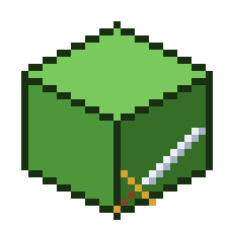
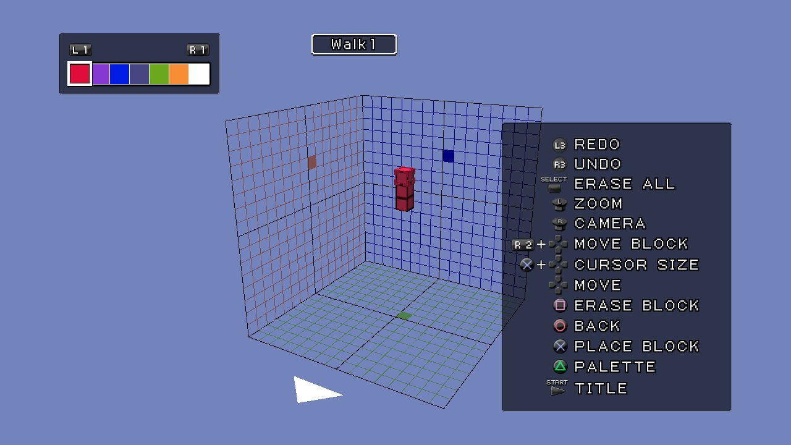
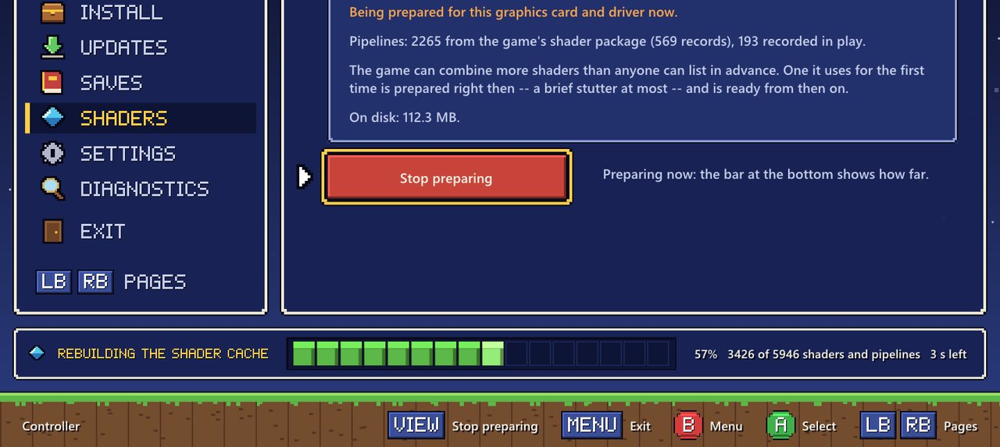

## Join the Cubic Heroes Discord!

**[Join us on Discord!](https://discord.gg/ZcafYCYb7A)**

Come hang out with the Cubic Heroes community! Keep up with the latest game updates, get help installing or troubleshooting, share your experiences, or just stop by to hype up the game and chat with fellow players.

Everyone is welcome, whether you're playing on Windows or Linux!

<p align="center">
  
</p>

<h1 align="center">Cubic.Heroes</h1>

<p align="center">
  <b>A native PC port of the PlayStation 3 game 3D Dot Game Heroes, rebuilt on your PC from your own disc.</b>
</p>

<p align="center">
  <a href="https://github.com/irnutsmurt/Cubic.Heroes/releases"></a>
  <a href="LICENSE"></a>
  
  
  
</p>

<p align="center">
  <a href="https://github.com/irnutsmurt/Cubic.Heroes/releases/tag/v0.2.0-beta.5"><b>Download the beta (0.2.0-beta.5, a pre-release: Windows and Linux)</b></a>
  &nbsp;·&nbsp; <a href="#quick-start">Quick start</a>
  &nbsp;·&nbsp; <a href="#if-the-installation-fails">Installation problems</a>
  &nbsp;·&nbsp; <a href="#known-issues">Known issues</a>
  &nbsp;·&nbsp; <a href="https://github.com/irnutsmurt/Cubic.Heroes/issues/new/choose">Report a bug</a>
</p>

> [!IMPORTANT]
> **This is a beta, a pre-release -- not a stable release.** The whole game plays, but not every part of it has been
> tested yet. Expect bugs, keep backups of your saves (the launcher makes them), and please
> [report what you find](https://github.com/irnutsmurt/Cubic.Heroes/issues/new/choose).
> **No game code, data or keys are included** -- you need your own copy of the game.
>
> **New in 0.2.0-beta.5: more ways to give your disc.** An ISO rebuilt from the disc's folder now installs, and every
> dump -- whatever its form -- is checked file by file against the verified game.

<p align="center">
  
</p>

**Cubic.Heroes** turns your own copy of the US PlayStation 3 release of **3D Dot Game Heroes** (Silicon Studio /
FromSoftware, 2009) into a native Windows or Linux game. The game's own program is **statically recompiled** -- its
PowerPC machine code translated ahead of time into C++ and compiled for x86-64 on your PC -- and runs on a native
engine reconstruction: a Vulkan renderer in place of the PS3's graphics chip, native code in place of its SPU
co-processor tasks, OpenAL Soft for audio and FFmpeg for the movies. Nothing is emulated or interpreted while you
play, and on Linux it is a native Linux program: no Wine, Proton or RPCS3.

It is a preservation project: the game's own logic, exactly as shipped, kept playable on today's PCs -- with the
improvements a PC version should have (high frame rates, any display mode, your own controls) and none of the game's
content changed. How it works, in detail: [docs/HOW_IT_WORKS.md](docs/HOW_IT_WORKS.md).

## Quick start

1. **Download** the package for your system from the
   [releases page](https://github.com/irnutsmurt/Cubic.Heroes/releases) ([which one?](#which-download)).
2. **Have ready**: a dump of your own **3D Dot Game Heroes (US, BLUS-30490)** disc, and your **keys file** for the
   game's program ([what you need](#what-you-need)).
3. **Start the launcher**, choose your disc and your keys file, and press **Install**. It checks your disc, then
   rebuilds the game on your PC: 10-30 minutes, once.
4. **Play.**

<p align="center">
  
</p>

## Contents

- [Quick start](#quick-start) · [Which download?](#which-download) · [What you need](#what-you-need)
- [Installing](#installing) · [If the installation fails](#if-the-installation-fails)
- [Playing](#playing) · [Updating](#updating) · [Troubleshooting](#troubleshooting)
- [Known issues](#known-issues) · [Reporting bugs](#reporting-bugs)
- [Screenshots](#screenshots) · [Features](#features) · [More documentation](#more-documentation)
- [This repository contains no game data](#this-repository-contains-no-game-data) · [License](#license)

## Which download?

Every file is on the [0.2.0-beta.5 release page](https://github.com/irnutsmurt/Cubic.Heroes/releases/tag/v0.2.0-beta.5),
with `SHA256SUMS.txt` and the signed manifest (`release.json`, `release.json.sig`) to check them against.

| Your system | Download | |
|---|---|---|
| **Windows 10 or 11** (64-bit) | `Cubic.Heroes-0.2.0-beta.5-windows-x86_64.zip` | extract it where the game should live |
| **Linux** (x86-64), most desktops | `Cubic.Heroes-0.2.0-beta.5-x86_64.AppImage` | one file; needs FUSE (`fusermount`), which most desktop distributions have |
| **Linux** without FUSE, or if you prefer a plain folder | `Cubic.Heroes-0.2.0-beta.5-linux-x86_64.tar.xz` | extract it where the game should live |

**Handhelds** (the Steam Deck among them) haven't been tested by us yet; on SteamOS the Linux packages are the ones to
use (in Desktop Mode; **Add to Steam** on the launcher's Install / Manage page then puts the game in Game Mode). Reports are very
welcome ([Testing status](docs/TESTING_STATUS.md)).

## What you need

**A PC**:
- **Windows 10 or 11, 64-bit**, or **Linux on x86-64 with glibc 2.31 or newer** (Debian 11, Ubuntu 20.04 and
  Fedora 32 have that glibc; see [Testing status](docs/TESTING_STATUS.md) for what has actually been tested).
- An **x86-64 CPU with SSE4.2** (x86-64-v2: Intel since 2008, AMD since 2011).
- A GPU with a **Vulkan** driver: any recent AMD, NVIDIA or Intel driver on Windows; on Linux, Mesa's (RADV for AMD,
  ANV for Intel) or NVIDIA's, with the Vulkan loader (`libvulkan1` or `vulkan-icd-loader`; installed with the driver
  on most distributions).
- About **6 GB** of free disk space.
- Nothing else to install: the launcher carries its own runtime (on Linux too: no Python or SDL from the system;
  the graphics driver and its Vulkan loader are the system's).

These are the minimum; recommended requirements will follow once more hardware has been tested.

**Your own copy of the game** -- only this release is supported:

| | |
|---|---|
| Title | 3D Dot Game Heroes (USA), PlayStation 3 |
| Product number | **BLUS-30490** |
| Version | 01.00 |

Other regions and releases are rejected (the recompilation is tied to this exact build's code). This project does not
include the game or its keys and does not tell you where to get them.

**A dump of your disc**, in any of these forms -- the launcher tells which one you chose and asks only for what that
form needs:

| Your dump | Also needs | |
|---|---|---|
| a **decrypted ISO** of the whole disc (3,332,812,800 bytes), as made by a PS3 running homebrew backup software in decrypted mode | -- | |
| an **ISO rebuilt from the disc's folder** (PS3 ISO Tools, makeps3iso and similar), of any size | -- | new in beta.5 |
| an **encrypted ISO** (a raw Blu-ray rip) | its **disc key** | decrypted as it is read; the ISO itself is never changed |
| the disc's **folder** (the one holding `PS3_GAME/`) | -- | |

Whatever the form, **every one of the game's files is checked** against its size and SHA-256 in the verified game's
manifest before anything is installed; a missing, changed or doubled file is refused, with its name.

**Your keys** -- two different things, for two different locks:

- **The disc key** -- *only for an encrypted ISO*. It unlocks the disc image itself. A `.dkey` file (the 32-character
  key), a `.key` file (16 bytes), the 32 characters typed, or an IRD file (which needs one more line, `D1`, in your
  keys file). A decrypted ISO, a rebuilt ISO or a folder doesn't need one, and the launcher doesn't ask for it.
- **The keys file for the game's program** -- *always*. The program (`PS3_GAME/USRDIR/EBOOT.BIN`) is encrypted on every
  dump, even a decrypted ISO. The keys file is a text file of `APP <revision> <erk> <riv>` lines (this game needs
  revision `0001`). Or, instead of a keys file, an `EBOOT.elf` you decrypted yourself (for example with RPCS3's
  *Utilities > Decrypt PS3 Binaries* using your own console's firmware).

If you choose one in the other's place, the launcher says so. Keys are only read: never copied, logged or uploaded.

## Installing

On every system the launcher does the same: you choose your disc (and its disc key if it is encrypted) and your keys
file, and it checks the disc, decrypts the game's program and **recompiles it on your PC** (10-30 minutes, depending
on your CPU), then prepares the shaders (a few seconds to a few minutes). Nothing of the game is downloaded: it is
built from your own files.

### Windows

1. **Download** `Cubic.Heroes-0.2.0-beta.5-windows-x86_64.zip`.
2. **Extract** it where you want the game to live -- for example `D:\Games\`. It unpacks to a `Cubic.Heroes` folder;
   that folder *is* the installation.
3. **Run `Cubic.Heroes\CubicHeroes.exe`**, choose your disc and your keys file, and **Install**.
4. **Shaders** are prepared right after the install; the launcher's Install / Manage page shows their state and can prepare
   them again after a GPU driver change.
5. **Play.**

An installation from an earlier version in `%LOCALAPPDATA%` is found on the first start and offered: copied into the
new folder and checked file by file, the earlier folder left as it was.

### Linux: the AppImage

1. **Download** `Cubic.Heroes-0.2.0-beta.5-x86_64.AppImage` into the folder you want the game in (for example
   `~/Games/`).
2. **Make it executable** -- `chmod +x Cubic.Heroes-0.2.0-beta.5-x86_64.AppImage`, or the file's Properties >
   Permissions -- and **start it**.
3. Choose your disc and your keys file, and **Install**, as on Windows.

The AppImage is one read-only file: its installation is a **`Cubic.Heroes` folder created beside it** (in the example,
`~/Games/Cubic.Heroes/`), holding everything listed under [The portable folder](#the-portable-folder). **Move the
AppImage and that folder together**, keeping them side by side.

**FUSE**: an AppImage is mounted with FUSE while it runs. This one carries its own FUSE library, so it only needs the
`fusermount` program and `/dev/fuse`, which most desktop distributions have (the `fuse3` or `fuse` package; `libfuse2`
isn't needed). Without FUSE (some containers and sandboxes), use **the tarball** below. `--appimage-extract-and-run` works too, but
leaves an extracted copy (about 450 MB) in `$TMPDIR` (normally `/tmp`) until it is deleted or the machine restarts
([docs/LINUX_PACKAGING.md](docs/LINUX_PACKAGING.md)).

### Linux: the tarball

1. **Download** `Cubic.Heroes-0.2.0-beta.5-linux-x86_64.tar.xz` and **extract** it where you want the game to live:
   `tar -xJf Cubic.Heroes-0.2.0-beta.5-linux-x86_64.tar.xz -C ~/Games`. It extracts to a `Cubic.Heroes` folder; that
   folder *is* the installation, exactly as on Windows.
2. **Run `Cubic.Heroes/CubicHeroes`**, choose your disc and your keys file, and **Install**.

The tarball needs no FUSE and leaves nothing outside its folder. The launcher (`CubicHeroes`), its runtime (`worker/`)
and its libraries (`lib/`) sit beside the installation's own folders.

## If the installation fails

The launcher says what went wrong and what to do; the most common cases:

| The launcher says | What to do |
|---|---|
| it is another game, region or version | Only BLUS-30490 version 01.00 (US) is supported; the message names what your dump is |
| the disc is damaged, or a file "doesn't match" | One of the game's files is missing, changed or incomplete in your dump: dump the disc again (or copy its folder again). An ISO of another size is fine as long as its files are right |
| the disc image is encrypted | It is a raw rip: choose its disc key too ([Your keys](#what-you-need)) |
| the disc key doesn't open this disc image | The key is for another disc: check it matches this dump |
| that is a disc key, not the keys file | Choose your keys file (the `APP` lines) or an `EBOOT.elf` there; the disc key goes in the disc key's own step |
| the keys file is refused, or the keys don't match | It needs an `APP` line for revision `0001`; or decrypt `EBOOT.BIN` yourself and give the `EBOOT.elf` |
| not enough space, or the folder can't be written | About 6 GB free is needed; extract to a folder you own (not `Program Files`) |
| the install stopped part-way | Run **Install** again: it resumes where it stopped. A failed or stopped install leaves the game you already have, your saves and your settings as they were |

Still stuck? **Diagnostics > Export Logs** (review it, then save the zip), and ask on
[Discord](https://discord.gg/ZcafYCYb7A) or [open an issue](https://github.com/irnutsmurt/Cubic.Heroes/issues/new/choose).
Every message and its fix: [docs/TROUBLESHOOTING.md](docs/TROUBLESHOOTING.md).

## Playing

| Keyboard | PS3 |
|---|---|
| Arrows | D-pad |
| Z / X / A / S | Cross / Circle / Square / Triangle |
| Q / W | L1 / R1 |
| 1 / 2 | L2 / R2 |
| 3 / 4 | L3 / R3 |
| Enter | Start |
| Tab | Select |

Any controller SDL2 recognises works, connected or disconnected while you play; buttons and keys can be changed in the
in-game menu. **The in-game menu**: hold **L3 + R3**, or press **F1** or **Esc** -- the game pauses while it is open.
The game's own START menu is unchanged; its title menu ends with **QUIT GAME**.

Settings are shared by the launcher and the in-game menu:

| Setting | Values |
|---|---|
| Display mode | windowed (resizable; its size and place remembered), borderless, exclusive fullscreen (your display's own mode) |
| Rendering resolution | native (default: your display's in fullscreen, the window's in a window), 1280x720 (the original), 1920x1080, 2560x1440, 3840x2160, custom -- changed while you play; independent of the display mode and the window's size; your display's own resolution is never changed |
| VSync | on / off, independent of the frame limit |
| Frame limit | 30 (the original), 60 (default), 75, 100, 120, 144, 165, 240, your display's rate, custom, unlimited |
| Volumes | master, music and effects, 0-100, and mute -- applied at once |
| Controls | your own controller buttons and keyboard keys; the button prompts (automatic, Xbox, PlayStation, Nintendo Switch, Steam, generic, keyboard and mouse); the in-game menu's shortcut |
| Performance overlay | off, the frame rate, or the frame rate and frame times |

### Other launchers

- **Steam** (Windows and Linux): the launcher's **Add to Steam** (Install / Manage) adds the launcher as a non-Steam game:
  Steam opens the launcher, and its Play starts the game. Close Steam first. It also downloads the library artwork onto your computer -- the poster by Fami-Kon
  and the hero image by Jib, hosted on SteamGridDB -- without replacing artwork you put there yourself; if that fails,
  the same page lets you choose the image files yourself. The library logo is Cubic.Heroes's own
  ([assets/steam-logo.png](assets/steam-logo.png)), placed from the launcher's files -- use it in other launchers too.
- **Heroic or Lutris** (Linux): add the tarball's `Cubic.Heroes/CubicHeroes` as a **native** game (not Wine or
  Proton) with the argument `--play`. Heroic's Flatpak can read only some folders (your Documents, the desktop, and
  others it already allows); for an installation elsewhere, allow it once with
  `flatpak override --user --filesystem=<the installation folder> com.heroicgameslauncher.hgl`.
- **Playnite, LaunchBox and others** (Windows): point them at `CubicHeroes.exe --play`.
- **RecompLauncher** (Windows and Linux): every package carries its manifest, so it can start the game and offer the
  display and prompt settings. The setup from your disc and keys stays in Cubic.Heroes's own launcher, which it opens
  at the first start; in that installation RecompLauncher then installs the updates, and Cubic.Heroes's own updater is
  off ([docs/RECOMPLAUNCHER.md](docs/RECOMPLAUNCHER.md)).

The launcher is also a command-line program, for these launchers and for scripts:

```bash
CubicHeroes --play                                   # the game directly, no launcher window; exits with the game
CubicHeroes --play --fps 144 --borderless            # this session only (add --persist to keep it)
CubicHeroes --status --json                          # installed? which build? shaders prepared? (machine-readable)
```

Every option, the JSON output, exit codes and integration examples: [docs/CLI.md](docs/CLI.md).

### The portable folder

Everything the game and the launcher make stays inside the `Cubic.Heroes` folder:

| Folder | What |
|---|---|
| `data/gamedata/` | **your saves** |
| `backups/saves/` | save backups (automatic before updates, and your own) |
| `config/` | settings (`dotheroes.cfg`), the window's place, the launcher's preferences |
| `builds/` | the recompiled game (the active build and the previous one) |
| `data/cache/` | shader, pipeline and compiler caches |
| `logs/` | logs; `logs/crash/` crash and hang reports |

Move the whole folder and it keeps working (to copy it, see
[The installation was copied](docs/TROUBLESHOOTING.md#the-installation-was-copied-game-is-in-the-way)). Nothing is
written to `AppData` by default; the only things outside it are the shortcuts and Steam entry you ask for and your GPU
driver's own caches. Another folder can be used for the data (`--install-dir`, or Settings). To remove everything, use
the launcher's uninstall, or delete the folder.

## Updating

**The launcher installs updates itself** (since 0.2.0-beta.4): Play's Updates section downloads a new version, checks it
against the project's release signature, and **Restart and update** puts it in place -- your saves (backed up first),
settings, caches and builds kept, and the previous launcher and build kept to go back to. Close the game first: an
update isn't installed while it runs.

**Coming from beta.2 or beta.3?** Their launchers can't install updates: install the current version by hand once
([docs/UPDATING.md](docs/UPDATING.md#from-beta2-or-beta3-once-by-hand)); updates install themselves after that.

Everything about updates, rollback and the command line: [docs/UPDATING.md](docs/UPDATING.md).

## Troubleshooting

| Problem | What to do |
|---|---|
| The installation fails | [If the installation fails](#if-the-installation-fails) |
| Stutter the first time somewhere | Install / Manage: prepare the shaders (again after a GPU driver update) |
| The game is too fast or slow | Report it with your frame limit and display rate; set the frame limit to 60 meanwhile |
| A black screen or the game won't start | Update your GPU driver (Vulkan); Diagnostics > Export Logs, and report it |
| Linux: the AppImage doesn't start | Make it executable (`chmod +x`); without FUSE, use the tarball |
| An update or repair fails with "...game is in the way (not a link)" | The installation folder was copied: [how to recover](docs/TROUBLESHOOTING.md#the-installation-was-copied-game-is-in-the-way) |
| Something else | Diagnostics > Export Logs, review, save the zip -- and [open an issue](https://github.com/irnutsmurt/Cubic.Heroes/issues/new/choose) |

More, with every Linux case (certificates, Heroic, Wayland, an AppImage in `/opt`):
[docs/TROUBLESHOOTING.md](docs/TROUBLESHOOTING.md).

## Known issues

- **B-011**: a hang was seen once in the priest's arena, 13 minutes into a long fight; not reproduced in more than two
  hours of the same fight since. If the game freezes, Diagnostics > Export Logs collects the hang report.
- **B-007**: one effect frame is missing when arriving at the castle battle's arena (cosmetic).
- The **minigames** run, but none has yet been played to its end in testing.
- The **extra Block Defense stage** is drawn pink in play; not yet compared with the original.
- The **purple spell** works only at its puzzle places, as on the original; two of its three places are still to be
  tested.
- The keyboard has no right stick: the camera's prompts keep a stick's picture there.
- The editor's own world, New Game+'s carry-over, the side quests and the consumables are not yet fully tested.
- **A copied installation folder** can stop updates, repairs and going back to an earlier build ("game is in the
  way"). It happens when the folder is copied in a way that turns its `game` link into a plain folder. See
  [The installation was copied](docs/TROUBLESHOOTING.md#the-installation-was-copied-game-is-in-the-way) for how to
  check and recover safely.
- **Coming from beta.2 or beta.3 takes one manual step**: their launchers can't install updates (and beta.3's can't
  reach the update server on Linux), so the current version is installed by hand once
  ([docs/UPDATING.md](docs/UPDATING.md#from-beta2-or-beta3-once-by-hand)); updates install themselves after that.
- **An update waits for the game to close**: the launcher doesn't install one while the game is running.
- **Windows: a console window flashes for about two seconds** after the launcher installs an update or removes itself:
  its helper waiting a moment, then deleting its own temporary copy. Nothing to do; a fix is planned.
- **An AppImage in a folder you can't write to** (`/opt`, for example) can't update itself: the launcher says so
  before downloading anything; download the new AppImage from the releases page instead.
- **Linux**:
  - without FUSE, use the tarball: an AppImage started with `--appimage-extract-and-run` leaves its extracted copy in
    `$TMPDIR` (normally `/tmp`) until it is deleted or the machine restarts;
  - on Wayland, exclusive fullscreen behaves as borderless fullscreen (the compositor owns the display mode);
  - on AMD graphics a few shadows and floor reflections differ slightly from the reference captures (faint; nothing
    missing or misplaced); being investigated.

What has been tested, and on what: [docs/TESTING_STATUS.md](docs/TESTING_STATUS.md).

### Reporting bugs

Use the [issue forms](https://github.com/irnutsmurt/Cubic.Heroes/issues/new/choose) -- gameplay, rendering, crashes and
hangs, performance, installation and the launcher, hardware -- and attach the launcher's **Diagnostics > Export Logs**
zip (review it first; it removes your name and paths). **Never attach game files, keys, save files or personal
information.**

## Screenshots

<table>
  <tr>
    <td width="50%"><br><sub>The overworld</sub></td>
    <td width="50%"><br><sub>A dungeon</sub></td>
  </tr>
  <tr>
    <td><br><sub>A boss battle (the sword's full-life beam)</sub></td>
    <td><br><sub>The character editor: build your own hero from blocks</sub></td>
  </tr>
  <tr>
    <td><br><sub>The controller-friendly launcher</sub></td>
    <td><br><sub>Every shader and pipeline prepared before you play</sub></td>
  </tr>
  <tr>
    <td><br><sub>PC display, frame-rate and performance settings</sub></td>
    <td><br><sub>QUIT GAME on the title menu</sub></td>
  </tr>
  <tr>
    <td><br><sub>The in-game settings menu (hold L3+R3, or F1)</sub></td>
    <td><br><sub>Loading a save</sub></td>
  </tr>
</table>

<sub>Screenshots taken in game via Windows 11.</sub>

## Features

- **Native, not emulated**: the game's program recompiled to x86-64 on your PC, a native Vulkan renderer, native
  physics, OpenAL Soft audio and FFmpeg for the movies; every shader and pipeline prepared ahead of play, so new places
  don't stutter ([how it works](docs/HOW_IT_WORKS.md)).
- **High frame rates** with the game's timing corrected where it counted frames (bosses, enemies): frame limits from
  30 (the original) to 240 fps, your display's rate, a custom value or unlimited; **VSync** on or off, independently.
- **Windowed, borderless or exclusive fullscreen**, the window's size and place remembered.
- **Rendering resolution** apart from the window: native (your display's), 720p (the original), 1080p, 1440p, 4K or
  custom -- above your display's for supersampling or below it for speed, the picture's shape always kept.
- **Keyboard and controller customization**: your own buttons and keys.
- **Button prompts throughout the game** in the style of what you play with -- switching by itself to the controller
  or keyboard you used last, or the one you choose: Xbox, PlayStation (the game's original pictures), Nintendo
  Switch, Steam, a generic controller, keyboard and mouse. Every menu, the HUD, messages, tutorials, shops, the
  character editor and the minigames show the button or key that does it, after your own remapping.
- **An in-game settings menu** over the paused game: display, audio, controls and performance, changed while you play.
- **QUIT GAME** on the title menu.
- **A controller-friendly launcher** (`CubicHeroes.exe` on Windows, `CubicHeroes` or the AppImage on Linux): install
  from your disc, prepare shaders, play, check for updates, roll back, back up and restore saves, export
  diagnostics -- with a controller, or a keyboard and mouse.
- **Characters** (0.2.0-beta.6): a character library in the launcher. It takes:
  - the heroes you build in the game's editor;
  - character files and ZIP archives;
  - characters saved on a PS3, which needs your own PS3 key.
  You can export and share characters, and install them in the game. The **Character Store** offers community
  characters to browse, download and install, among them 352 recovered from the 2010 Hall of Heroes. See
  [CHARACTERS.md](docs/CHARACTERS.md) and [CHARACTER_STORE.md](docs/CHARACTER_STORE.md).
- **A portable installation**, **signed updates with rollback**, **save backups**, **crash reports and a private
  diagnostics export**, and **other launchers** (Steam by Add to Steam; Heroic, Lutris, Playnite through `--play`)
  ([all of it](docs/HOW_IT_WORKS.md#features-in-detail)).

## More documentation

| | |
|---|---|
| [docs/HOW_IT_WORKS.md](docs/HOW_IT_WORKS.md) | what the launcher does with your disc, what replaces the PS3's hardware, the features in detail |
| [docs/TESTING_STATUS.md](docs/TESTING_STATUS.md) | what has been tested, on which systems |
| [docs/UPDATING.md](docs/UPDATING.md) | updates, rollback, coming from beta.2 or beta.3 |
| [docs/TROUBLESHOOTING.md](docs/TROUBLESHOOTING.md) | every known problem and its fix |
| [docs/CLI.md](docs/CLI.md) | the command line: every option, JSON output, exit codes |
| [docs/CHARACTERS.md](docs/CHARACTERS.md) | the character library: formats, PS3 characters and your key, import, export, install |
| [docs/CHARACTER_STORE.md](docs/CHARACTER_STORE.md) | the Character Store: the signed catalog, community and recovered historical characters, removal requests |
| [docs/ROADMAP.md](docs/ROADMAP.md) | what is done and what is planned |
| [docs/BUILDING.md](docs/BUILDING.md) | building from source (for developers) |
| [docs/LINUX_PACKAGING.md](docs/LINUX_PACKAGING.md) | the Linux packages in detail |

## This repository contains no game data

This project distributes the **tools that rebuild the game from your own disc**, not the game. The repository and
the download hold the recompilation tools, this project's independently written runtime code, the open-source
libraries it builds on, configuration, tests and documentation. They never hold the game's code (extracted, lifted or
translated), a built game or anything compiled from it, the game's assets, sounds, music, textures or movies,
proprietary middleware, decryption keys or firmware, or anyone's saves. Everything derived from the game is made on
your own machine and must not be redistributed. `tools/boundary_check.py` checks this on every push and on the download
before and after it is packed.

The game files' manifest (`config/disc_manifest.json`) lists each file's name, size and SHA-256 only -- enough to
check your dump, nothing of the files themselves.

The **screenshots** in `docs/media/` are pictures of the game running, captured from a player's own installation to
illustrate this documentation. They are not game assets and nothing playable can be made from them; they are kept
apart from the download, which never contains them.

## License

This project's code is licensed under the **GNU General Public License v3.0** ([`LICENSE`](LICENSE)). The licence
covers this project's own code and images only. 3D Dot Game Heroes belongs to its rights holders (developed by Silicon
Studio, published by FromSoftware, and by Atlus in North America); none of its code or data is part of this
repository, and the GPL grants no rights to it.

Third-party components keep their own licences (their texts and, where the licence asks, their sources ship in the
download's `licenses/` folders):

| Component | Licence | Use |
|---|---|---|
| [ps3recomp](https://github.com/sp00nznet/ps3recomp) (patched, `patches/ps3recomp/`) | MIT | the recompiler and PS3 runtime |
| at3_standalone (in ps3recomp, from PPSSPP/FFmpeg) | LGPL-2.1 | ATRAC3plus decoding (its source ships in the download) |
| [SDL2](https://libsdl.org) | zlib | window and input |
| [Dear ImGui](https://github.com/ocornut/imgui) | MIT | the launcher's interface |
| [OpenAL Soft](https://openal-soft.org) 1.25.2 | LGPL-2.0-or-later (parts BSD-3-Clause, PFFFT's licence, {fmt}'s and Microsoft GSL's MIT) | the game's audio: a shared library, unmodified, its source in the download |
| [FFmpeg](https://ffmpeg.org) 9.0.2 | LGPL-2.1-or-later | the movies: avutil, avcodec and avformat with the Bink demuxer and decoders only, shared libraries, unmodified, their source and build configuration in the download |
| [glslang](https://github.com/KhronosGroup/glslang) | BSD-3-Clause and others | the game's shaders, translated |
| [Vulkan-Headers](https://github.com/KhronosGroup/Vulkan-Headers) | Apache-2.0 / MIT | building the renderer |
| [Bullet Physics](https://github.com/bulletphysics/bullet3) 2.74 | zlib | the native physics: its narrowphase compiled from source; `bullet_cd.cpp` and `bullet_solver.cpp` are altered versions of its algorithms and carry its notice |
| [Zig](https://ziglang.org) | MIT | the bundled compiler |
| [Python](https://www.python.org) 3.12 (with OpenSSL, libffi, zlib, bzip2 and the other libraries its Windows build carries) | PSF License 2.0; the libraries' own (Apache-2.0, MIT, zlib, BSD) | the worker's runtime |
| [PyInstaller](https://pyinstaller.org)'s bootloader | GPL-2.0-or-later with its bootloader exception | starts the packed worker |
| [pycryptodome](https://www.pycryptodome.org) | BSD-2-Clause / public domain | decrypting the game's program |
| [DejaVu Sans](https://dejavu-fonts.github.io) (`port/assets/ui/`) | Bitstream Vera / DejaVu font licence | interface text |
| [Kenney input prompts](https://kenney.nl) (`port/assets/ui/`) | CC0 | controller button prompts |

> **Built with AI.** This project's code -- the pipeline, the runtime changes and patches, the launcher and the
> tooling -- was written by AI ([Claude Code](https://claude.com/claude-code), Anthropic's Claude), with a human
> directing and testing it. This repository was called `3D-Dot-Game-Heroes-PS3-Recomp` until November 2026; links to
> the old name lead here.
