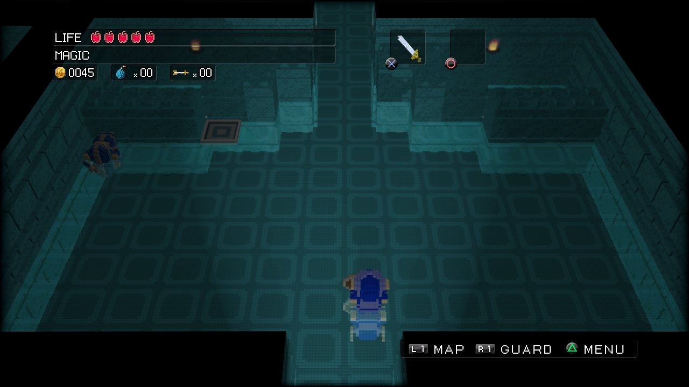
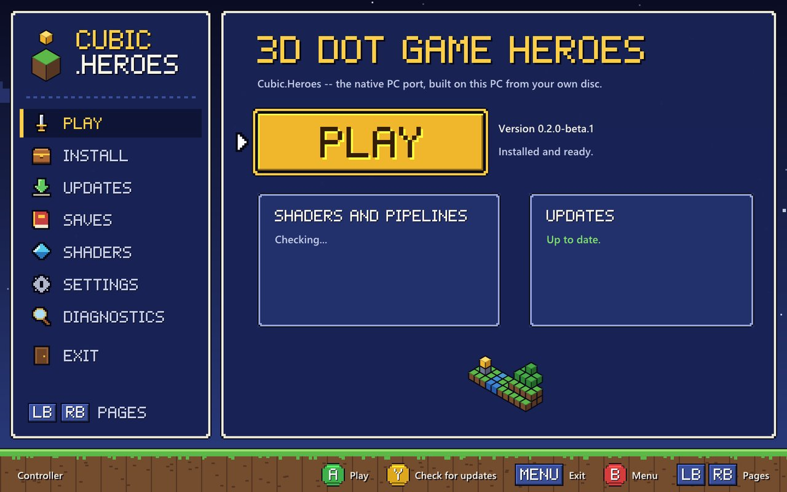
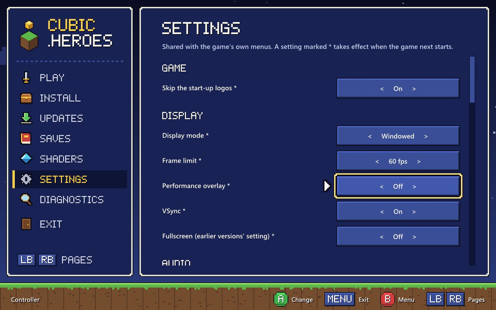
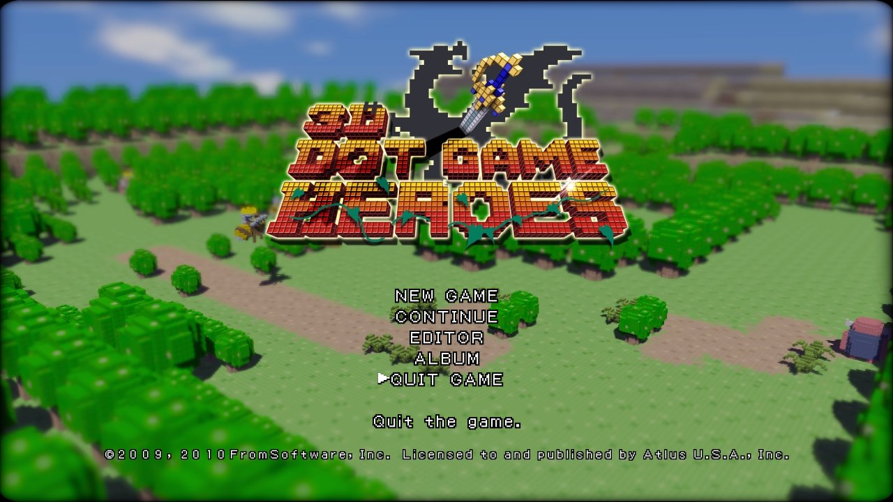

<p align="center">
  
</p>

<h1 align="center">Cubic.Heroes</h1>

<p align="center">
  <b>A native PC port of the PlayStation 3 game 3D Dot Game Heroes, rebuilt on your PC from your own disc.</b>
</p>

<p align="center">
  <a href="https://github.com/irnutsmurt/Cubic.Heroes/releases"></a>
  <a href="LICENSE"></a>
  
  
  
</p>

<p align="center">
  <a href="https://github.com/irnutsmurt/Cubic.Heroes/releases/tag/v0.2.0-beta.1"><b>Download the beta (0.2.0-beta.1, Windows)</b></a>
  &nbsp;·&nbsp; <a href="#installation">Installation</a>
  &nbsp;·&nbsp; <a href="docs/CLI.md">Command line</a>
  &nbsp;·&nbsp; <a href="#known-issues">Known issues</a>
  &nbsp;·&nbsp; <a href="https://github.com/irnutsmurt/Cubic.Heroes/issues/new/choose">Report a bug</a>
</p>

> [!IMPORTANT]
> **This is a beta.** 0.2.0-beta.1 is the first public test release: the whole game plays, but not every part of it
> has been tested yet. Expect bugs, keep backups of your saves (the launcher makes them), and please
> [report what you find](https://github.com/irnutsmurt/Cubic.Heroes/issues/new/choose).
> **No game code, data or keys are included** -- you need your own copy of the game.

<p align="center">
  
</p>

**Cubic.Heroes** turns your own copy of the US PlayStation 3 release of **3D Dot Game Heroes** (Silicon Studio /
FromSoftware, 2009) into a native Windows game. The game's own program is **statically recompiled** -- its PowerPC
machine code translated ahead of time into C++ and compiled for x86-64 on your PC -- and runs on a native engine
reconstruction: a Vulkan renderer in place of the PS3's graphics chip, native code in place of its SPU co-processor
tasks, OpenAL Soft for audio and FFmpeg for the movies. Nothing is emulated or interpreted while you play.

It is a preservation project: the game's own logic, exactly as shipped, kept playable on today's PCs -- with the
improvements a PC version should have (high frame rates, any display mode, your own controls) and none of the game's
content changed.

## Contents

- [Screenshots](#screenshots)
- [Features](#features)
- [How it works](#how-it-works)
- [Installation](#installation) · [Playing](#playing) · [Updating](#updating) · [Command line](#command-line)
- [Troubleshooting](#troubleshooting)
- [Testing status](#testing-status) · [Known issues](#known-issues) · [Reporting bugs](#reporting-bugs)
- [Roadmap](#roadmap)
- [Building from source](#building-from-source)
- [This repository contains no game data](#this-repository-contains-no-game-data)
- [License](#license)

## Screenshots

<table>
  <tr>
    <td width="50%"><br><sub>The overworld</sub></td>
    <td width="50%"><br><sub>A dungeon</sub></td>
  </tr>
  <tr>
    <td><br><sub>A boss battle (the sword's full-life beam)</sub></td>
    <td><br><sub>The character editor: build your own hero from blocks</sub></td>
  </tr>
  <tr>
    <td><br><sub>The controller-friendly launcher</sub></td>
    <td><br><sub>Every shader and pipeline prepared before you play</sub></td>
  </tr>
  <tr>
    <td><br><sub>PC display, frame-rate and performance settings</sub></td>
    <td><br><sub>QUIT GAME on the title menu</sub></td>
  </tr>
</table>

<sub>Screenshots taken in game via Windows 11.</sub>

## Features

**The game, native**
- **Static recompilation to x86-64**: the game's PPU program is translated ahead of time to C++ and compiled on your PC
  for your CPU; no interpreter, no just-in-time compiler.
- **A native Vulkan renderer**: the game's PS3 graphics backend and its post-processing are drawn natively; the PS3's
  graphics command stream is not generated or decoded at all. The game's shaders are translated to SPIR-V.
- **Native physics and SPU workloads**: collision, the physics solver, the map packs' decompression, the water and the
  hero's waving cloth run as native code; no SPU program runs. (The water's and the cloth's native code is generated on
  your PC from your own copy.)
- **OpenAL Soft audio** in place of the game's proprietary audio middleware, and **FFmpeg** for the cinematics -- the
  middleware's code is left out of your recompiled game entirely.
- **Comprehensive shader and pipeline preparation**: every shader and pipeline the game uses (2,458 on the reference
  PC) is prepared ahead of play, so new places don't stutter.

**PC features**
- **High frame rates** with the game's timing corrected where it counted frames (bosses, enemies): frame limits from
  30 (the original) to 240 fps, your display's rate, a custom value or unlimited; **VSync** on or off, independently.
- **Windowed, borderless or exclusive fullscreen**, the window's size and place remembered.
- **Keyboard and controller customization**: your own buttons and keys, with the prompts of your controller
  (Xbox, PlayStation, Nintendo).
- **An in-game settings menu** over the paused game: display, audio, controls and performance, changed while you play.
- **QUIT GAME** on the title menu.

**Launcher and installation**
- **A controller-friendly launcher** (`CubicHeroes.exe`): install from your disc, prepare shaders, play, update, roll
  back, back up and restore saves, export diagnostics -- with a controller, or a keyboard and mouse.
- **Portable installation**: everything stays in one folder -- the recompiled game, saves and backups, settings, shader
  caches, logs. Move it and it keeps working.
- **Direct play from the command line**, and **third-party launcher integration**: `CubicHeroes --play` starts the
  game without the launcher's window and exits with it; `--status --json` and a headless `--install` for scripts;
  "Add to Steam" and Start-menu shortcuts.
- **Signed updates and rollback**: updates are offered only if signed with the project's release key; the game is
  rebuilt only when something it is made of changed; the previous build is kept to go back to.
- **Save backups and restoration**: automatic before every update, and on demand.
- **Diagnostics and crash reporting**: crash and hang reports, logs, and a diagnostics export that removes your name,
  paths and e-mail addresses and never includes saves, keys or game files.
- **Optional developer mode** for testers: warp anywhere, set the story's progress, spawn enemies and bosses -- on test
  saves of its own, never yours, and fully off unless switched on.

## How it works

1. **Your disc is checked** (its SHA-256 against the one supported release) and the game's program is decrypted with
   your own keys.
2. **The program is recompiled**: each PowerPC function becomes a C++ function, compiled with a bundled Zig/Clang
   toolchain into a native x86-64 executable on your PC. Your recompiled game
   never leaves your machine.
3. **The PS3's hardware work is done natively** -- not emulated:

| On the PS3 | In Cubic.Heroes |
|---|---|
| RSX graphics chip, its command buffer and the game's GCM graphics backend | a native Vulkan renderer fed from the game's own draw data; no command stream is generated or decoded |
| Shader programs (NV40 microcode) | translated to SPIR-V and prepared ahead of play |
| SPU co-processor tasks (physics, water, cloth, decompression) | native C++ (the physics derived from Bullet 2.74's algorithms; the water and cloth generated from your copy's code) |
| The game's audio middleware | a native sound manager on OpenAL Soft (the middleware's code is not compiled) |
| Bink video | FFmpeg's open-source Bink decoder |
| The PS3's pad, file system, save data, threads and timers | native implementations of the system interfaces the game calls |

**What remains PS3-shaped**, to be precise: the recompiled game still runs on its own big-endian memory layout and
calls the PS3 system interfaces it was written against (memory and display-buffer mapping, flip status, pad, file
system, save data, threads, locks and events); those interfaces are implemented natively on the PC, not emulated. The
game also still creates the (now empty) SPU task-scheduler instances it expects; no task is ever given to them. The
recompiler and runtime are [ps3recomp](https://github.com/sp00nznet/ps3recomp), patched by this project
(`patches/ps3recomp/`).

## Installation

### What you need

- **Windows 10 or 11, 64-bit**, an x86-64 CPU with SSE4.2 (Intel since 2008, AMD since 2011), a GPU with a
  **Vulkan** driver (any recent AMD, NVIDIA or Intel driver), and about **6 GB** of free disk space.
  These are the minimum; recommended requirements will follow once more hardware, and Linux, have been tested.
- **Your own copy of the game** -- only this release is supported:

| | |
|---|---|
| Title | 3D Dot Game Heroes (USA), PlayStation 3 |
| Product number | **BLUS-30490** |
| Version | 01.00 |

  Other regions and releases are rejected (the recompilation is tied to this exact build's code). This project does
  not include the game or its keys and does not tell you where to get them.
- **A dump of your disc**, one of:
  - a **decrypted ISO** (3,332,812,800 bytes), as made by a PS3 running homebrew backup software in decrypted mode;
  - an **encrypted ISO** (a raw Blu-ray rip) with its **disc key** (a `.dkey` file, the 32-character key, or an IRD
    file) -- decrypted as it is read; the ISO itself is never changed;
  - the disc's **folder** (the one holding `PS3_GAME/`).
- **Your keys file** to decrypt the game's program (`APP <revision> <erk> <riv>` lines; this game needs revision
  `0001`), or an `EBOOT.elf` you decrypted yourself (for example with RPCS3's *Utilities > Decrypt PS3 Binaries*
  using your own console's firmware). The keys are only read: never copied, logged or uploaded.

### Steps

1. **Download** `Cubic.Heroes-0.2.0-beta.1-windows-x86_64.zip` from the
   [release page](https://github.com/irnutsmurt/Cubic.Heroes/releases/tag/v0.2.0-beta.1) and check it against
   `SHA256SUMS.txt` if you like.
2. **Extract** it where you want the game to live -- for example `D:\Games\`. It unpacks to a `Cubic.Heroes` folder;
   that folder *is* the installation.
3. **Run `Cubic.Heroes\CubicHeroes.exe`**, choose your disc and your keys file, and **Install**. The launcher checks
   the disc, decrypts the program, recompiles it and builds the game on your PC: **10-30 minutes**, depending on your
   CPU.
4. **Shaders** are prepared right after the install (a few seconds to a few minutes); the launcher's Shaders page
   shows their state and can prepare them again after a GPU driver change.
5. **Play.**

An installation from an earlier version in `%LOCALAPPDATA%` is found on the first start and offered: copied into the
new folder and checked file by file, the earlier folder left as it was.

### The portable folder

Everything the game and the launcher make stays inside the `Cubic.Heroes` folder:

| Folder | What |
|---|---|
| `data/gamedata/` | **your saves** |
| `backups/saves/` | save backups (automatic before updates, and your own) |
| `config/` | settings (`dotheroes.cfg`), the window's place, the launcher's preferences |
| `builds/` | the recompiled game (the active build and the previous one) |
| `data/cache/` | shader, pipeline and compiler caches |
| `logs/` | logs; `logs/crash/` crash and hang reports |

Move or copy the whole folder and it keeps working. Nothing is written to `AppData` by default; the only things
outside it are the shortcuts and Steam entry you ask for and your GPU driver's own caches. Another folder can be used
for the data (`--install-dir`, or Settings). To remove everything, use the launcher's uninstall, or delete the folder.

## Playing

| Keyboard | PS3 |
|---|---|
| Arrows | D-pad |
| Z / X / A / S | Cross / Circle / Square / Triangle |
| Q / W | L1 / R1 |
| 1 / 2 | L2 / R2 |
| 3 / 4 | L3 / R3 |
| Enter | Start |
| Tab | Select |

Any controller SDL2 recognises works, connected or disconnected while you play; buttons and keys can be changed in the
in-game menu. **The in-game menu**: hold **L3 + R3**, or press **F1** or **Esc** -- the game pauses while it is open.
The game's own START menu is unchanged; its title menu ends with **QUIT GAME**.

Settings are shared by the launcher and the in-game menu:

| Setting | Values |
|---|---|
| Display mode | windowed (resizable; its size and place remembered), borderless, exclusive fullscreen (your display's own mode) |
| VSync | on / off, independent of the frame limit |
| Frame limit | 30 (the original), 60 (default), 75, 100, 120, 144, 165, 240, your display's rate, custom, unlimited |
| Volumes | master, music and effects, 0-100, and mute -- applied at once |
| Controls | your own controller buttons and keyboard keys; the prompts' style; the in-game menu's shortcut |
| Performance overlay | off, the frame rate, or the frame rate and frame times |

## Updating

The launcher checks for new versions and updates itself and the game **in place**: your saves are backed up first, the
game is rebuilt only if something it is made of changed (no disc needed), and the previous build is kept --
**Updates > Rollback Last Update** goes back to it. Betas are offered on the pre-release channel (a beta's default;
Settings > Updates). Every update is checked against the project's release signature before anything is installed.

## Command line

`CubicHeroes.exe` is also a command-line program -- for other launchers, Steam and scripts:

```bash
CubicHeroes --play                                   # the game directly, no launcher window; exits with the game
CubicHeroes --play --fps 144 --borderless            # this session only (add --persist to keep it)
CubicHeroes --status --json                          # installed? which build? shaders prepared? (machine-readable)
CubicHeroes --install --disc "D:\Dumps\BLUS30490.iso" --keys "D:\Keys\keys.txt"   # headless install
CubicHeroes --update                                 # bring the game up to date (rebuilds only what changed)
CubicHeroes --prepare-shaders
CubicHeroes --install-dir "E:\Games\Cubic.Heroes" --play   # another installation folder
```

For Steam, Playnite, LaunchBox and similar: point them at `CubicHeroes.exe --play`; it stays running for as long as
the game does and returns its exit code. Everything -- every option, the JSON output, exit codes and integration
examples -- is in **[docs/CLI.md](docs/CLI.md)**.

## Troubleshooting

| Problem | What to do |
|---|---|
| The disc is refused | Only BLUS-30490 version 01.00 is supported; check the dump (size 3,332,812,800 bytes for an ISO) |
| The keys file is refused | It needs an `APP` line for revision `0001`; or decrypt `EBOOT.BIN` yourself and give the `EBOOT.elf` |
| The install stopped part-way | Run Install again: it resumes where it stopped |
| Stutter the first time somewhere | Shaders page: prepare them (again after a GPU driver update) |
| The game is too fast or slow | Report it with your frame limit and display rate; set the frame limit to 60 meanwhile |
| A black screen or the game won't start | Update your GPU driver (Vulkan); Diagnostics > Export Logs, and report it |
| The folder can't be written | Extract to a folder you own (not `Program Files`); the launcher says if it can't write |
| Something else | Diagnostics > Export Logs, review, save the zip -- and [open an issue](https://github.com/irnutsmurt/Cubic.Heroes/issues/new/choose) |

## Testing status

The beta has been validated area by area on Windows 11 with an NVIDIA GPU: every reachable map visited (166 of 167), every boss fought to
its defeat (and won by the game's own mechanics where they need one), the ending and credits, saving and loading,
frame-rate independence of movement at 30, 60, 144 and 240 fps for every enemy type and the bosses, the movies, every
event the game places, the installation, updates and rollback -- with automated scenarios, the developer tools and comparisons against RPCS3. The
full matrix, with what is still `partial` or `todo`, is [docs/M11_VALIDATION.md](docs/M11_VALIDATION.md); the release
checks are [docs/RELEASE_QUALIFICATION.md](docs/RELEASE_QUALIFICATION.md). **Not every part of the game has been
tested**, and other GPUs (AMD, Intel), Windows 10 and handhelds have not been tested at all -- reports are very welcome.

### Known issues

- **B-011**: a hang was seen once in the priest's arena, 13 minutes into a long fight; not reproduced in more than two
  hours of the same fight since. If the game freezes, Diagnostics > Export Logs collects the hang report.
- **B-007**: one effect frame is missing when arriving at the castle battle's arena (cosmetic).
- The **minigames** run, but none has yet been played to its end in testing.
- The **extra Block Defense stage** is drawn pink in play; not yet compared with the original.
- The **purple spell** has not been cast in testing (it is crossed out where it was tried, as on the original).
- The editor's own world, New Game+'s carry-over, the side quests and the consumables are not yet fully tested.
- **Linux is not available yet.**

### Reporting bugs

Use the [issue forms](https://github.com/irnutsmurt/Cubic.Heroes/issues/new/choose) -- gameplay, rendering, crashes and
hangs, performance, installation and the launcher, hardware -- and attach the launcher's **Diagnostics > Export Logs**
zip (review it first; it removes your name and paths). **Never attach game files, keys, save files or personal
information.**

## Roadmap

Planned, not yet available:

- **Completing the gameplay validation** -- the rows still open in the matrix, and what testers report.
- **A native Linux release** -- an **AppImage** and a **tarball** for x86-64 ([docs/LINUX_PACKAGING.md](docs/LINUX_PACKAGING.md)).
- **Steam Deck** compatibility.
- **Optional hardware-accelerated ray tracing** (RTX and other GPUs with ray tracing).
- **HDR** output (being considered).
- **Character import, export and community sharing** -- the editor's heroes as files, and a shared library.

## Building from source

For developers. A clone builds the tools and the runtime -- not the game, which still needs your own disc.

- Windows: Python 3.12 in `build/venv` (with `pycryptodome`, `pillow`, `pyinstaller`), CMake, Ninja, Zig 0.17 in
  `build/toolchain/`, the Vulkan SDK.
- Linux: Python 3.10+ with `pycryptodome`, CMake, Ninja, clang, SDL2, Vulkan headers, glslang
  ([docs/SETUP.md](docs/SETUP.md)).

```sh
python3 tools/pipeline.py --iso "<your BLUS-30490>.iso" --keys <keys.txt>   # extract, decrypt, lift into build/gen
cmake -S port -B build/port -G Ninja -DPS3RECOMP_RSX_VULKAN=ON
cmake --build build/port
build/port/dotheroes build/disc/PS3_GAME/USRDIR/EBOOT.elf
```

The pipeline clones [ps3recomp](https://github.com/sp00nznet/ps3recomp) at a pinned revision and applies this
project's patch series (`patches/ps3recomp/`). The downloads: `tools/build_deps.py`, then
`tools/make_bundle.py --prebuilt` (the launcher with `tools/build_launcher.py`). Before every push the pre-push hook
runs `tools/boundary_check.py` and `tools/push_guard.py` (`git config core.hooksPath tools/githooks`).

| Path | What |
|---|---|
| `launcher/` | the launcher, `CubicHeroes` (SDL2 and Dear ImGui), and its command line |
| `setup_app.py`, `tools/worker.py` | the worker the launcher runs: install, update, prepare, diagnostics |
| `tools/` | the recompilation pipeline, the build with Zig, the downloads, the checks |
| `patches/ps3recomp/` | this project's changes to the ps3recomp recompiler and runtime |
| `port/` | the native program: start-up, the native renderer's hooks, physics, audio, the in-game menu, diagnostics |
| `config/` | the exact game version (hashes), the recompiler's inputs, the settings schema, the release keys |
| `tests/` | test harnesses, scenarios and the unit tests |
| `docs/` | design records, milestones, validation, the command line |

## This repository contains no game data

This project distributes the **tools that rebuild the game from your own disc**, not the game. The repository and
the download hold the recompilation tools, this project's independently written runtime code, the open-source
libraries it builds on, configuration, tests and documentation. They never hold the game's code (extracted, lifted or
translated), a built game or anything compiled from it, the game's assets, sounds, music, textures or movies,
proprietary middleware, decryption keys or firmware, or anyone's saves. Everything derived from the game is made on
your own machine and must not be redistributed. `tools/boundary_check.py` checks this on every push and on the download
before and after it is packed.

The **screenshots** in `docs/media/` are pictures of the game running, captured from a player's own installation to
illustrate this documentation. They are not game assets and nothing playable can be made from them; they are kept
apart from the download, which never contains them.

## License

This project's code is licensed under the **GNU General Public License v3.0** ([`LICENSE`](LICENSE)). The licence
covers this project's own code and images only. 3D Dot Game Heroes belongs to its rights holders (developed by Silicon
Studio, published by FromSoftware, and by Atlus in North America); none of its code or data is part of this
repository, and the GPL grants no rights to it.

Third-party components keep their own licences (their texts and, where the licence asks, their sources ship in the
download's `licenses/` folders):

| Component | Licence | Use |
|---|---|---|
| [ps3recomp](https://github.com/sp00nznet/ps3recomp) (patched, `patches/ps3recomp/`) | MIT | the recompiler and PS3 runtime |
| at3_standalone (in ps3recomp, from PPSSPP/FFmpeg) | LGPL-2.1 | ATRAC3plus decoding (its source ships in the download) |
| [SDL2](https://libsdl.org) | zlib | window and input |
| [Dear ImGui](https://github.com/ocornut/imgui) | MIT | the launcher's interface |
| [OpenAL Soft](https://openal-soft.org) 1.25.2 | LGPL-2.0-or-later (parts BSD-3-Clause, PFFFT's licence, {fmt}'s and Microsoft GSL's MIT) | the game's audio: a shared library, unmodified, its source in the download |
| [FFmpeg](https://ffmpeg.org) 9.0.2 | LGPL-2.1-or-later | the movies: avutil, avcodec and avformat with the Bink demuxer and decoders only, shared libraries, unmodified, their source and build configuration in the download |
| [glslang](https://github.com/KhronosGroup/glslang) | BSD-3-Clause and others | the game's shaders, translated |
| [Vulkan-Headers](https://github.com/KhronosGroup/Vulkan-Headers) | Apache-2.0 / MIT | building the renderer |
| [Bullet Physics](https://github.com/bulletphysics/bullet3) 2.74 | zlib | the native physics: its narrowphase compiled from source; `bullet_cd.cpp` and `bullet_solver.cpp` are altered versions of its algorithms and carry its notice |
| [Zig](https://ziglang.org) | MIT | the bundled compiler |
| [Python](https://www.python.org) 3.12 (with OpenSSL, libffi, zlib, bzip2 and the other libraries its Windows build carries) | PSF License 2.0; the libraries' own (Apache-2.0, MIT, zlib, BSD) | the worker's runtime |
| [PyInstaller](https://pyinstaller.org)'s bootloader | GPL-2.0-or-later with its bootloader exception | starts the packed worker |
| [pycryptodome](https://www.pycryptodome.org) | BSD-2-Clause / public domain | decrypting the game's program |
| [DejaVu Sans](https://dejavu-fonts.github.io) (`port/assets/ui/`) | Bitstream Vera / DejaVu font licence | interface text |
| [Kenney input prompts](https://kenney.nl) (`port/assets/ui/`) | CC0 | controller button prompts |

> **Built with AI.** This project's code -- the pipeline, the runtime changes and patches, the launcher and the
> tooling -- was written by AI ([Claude Code](https://claude.com/claude-code), Anthropic's Claude), with a human
> directing and testing it. This repository was called `3D-Dot-Game-Heroes-PS3-Recomp` until November 2026; links to
> the old name lead here.
