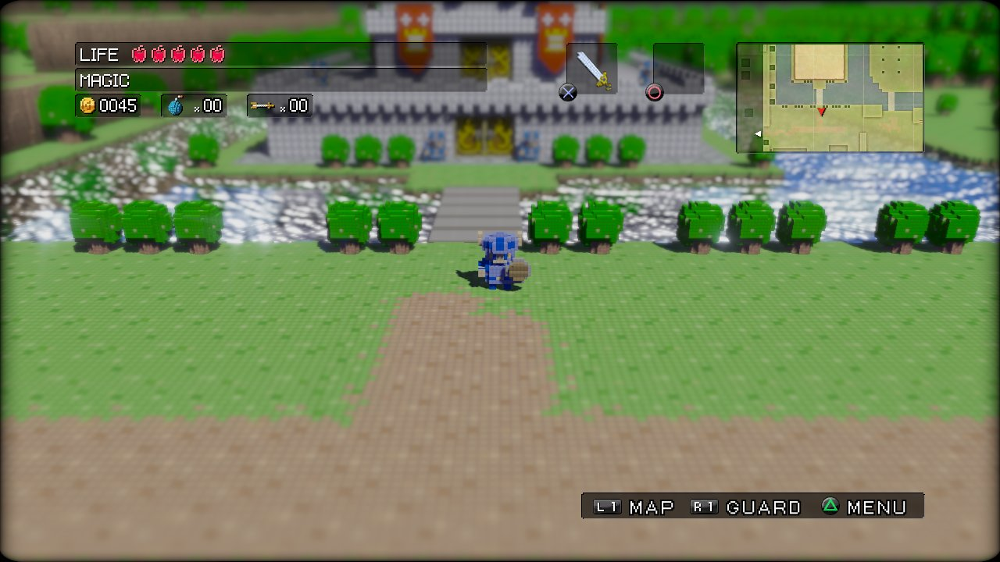
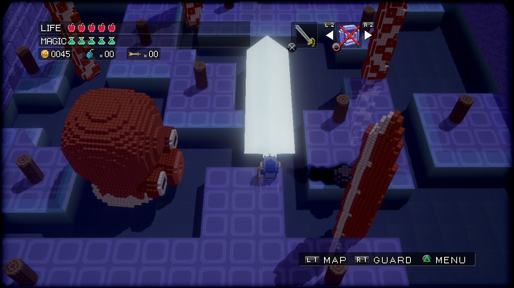
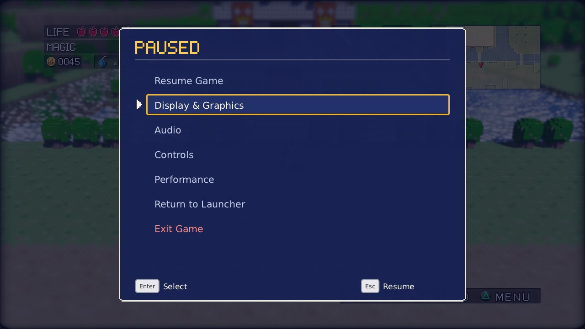

  

<h1 align="center">Cubic.Heroes</h1>

  <b>A native PC port of the PlayStation 3 game 3D Dot Game Heroes, rebuilt on your PC from your own disc.</b>

  
  
  
  
  

  <a href="https://github.com/irnutsmurt/Cubic.Heroes/releases/tag/v0.2.0-beta.5"><b>Download the beta (0.2.0-beta.5: Windows and Linux)</b></a>
  &nbsp;·&nbsp; <a href="#installation">Installation</a>
  &nbsp;·&nbsp; <a href="https://discord.gg/ZcafYCYb7A">Discord</a>
  &nbsp;·&nbsp; <a href="https://github.com/irnutsmurt/Cubic.Heroes/issues/new/choose">Report a bug</a>

  

**Cubic.Heroes** turns your own copy of the US PlayStation 3 release of **3D Dot Game Heroes** (Silicon Studio /
FromSoftware, 2009) into a native Windows or Linux game. The game's own program is recompiled for your PC ahead of
time and runs on a native engine: Vulkan graphics, OpenAL Soft audio and FFmpeg movies. Nothing is emulated while you
play, and on Linux it is a native Linux program (no Wine, Proton or RPCS3). It adds what a PC version should have --
high frame rates, any display mode, your own controls -- and changes none of the game's content.

> [!IMPORTANT]
> **This is a beta, a pre-release.** The whole game plays, but not every part of it has been tested yet: expect bugs,
> and please [report what you find](https://github.com/irnutsmurt/Cubic.Heroes/issues/new/choose).
> **No game code, data or keys are included** -- you need your own copy of the game.

## Installation

**What you need**

- **A PC**: Windows 10 or 11 (64-bit), or Linux on x86-64; a GPU with a Vulkan driver; about 6 GB of free space
  ([full requirements](docs/INSTALLING.md#the-pc)).
- **Your own disc of 3D Dot Game Heroes**: US, **BLUS-30490**, version 01.00. As a dump: an ISO (decrypted, rebuilt
  from the disc's folder, or encrypted with its disc key) or the disc's folder ([every form](docs/INSTALLING.md#your-discs-dump)).
- **Your keys** for the game's program (the APP key of revision `0001`). Keep them beside your ISO -- a keys file,
  or a folder or ZIP of key files -- and the launcher finds them by itself. Or choose them, an `EBOOT.elf` you
  decrypted, or your own RPCS3 if you have it ([what the keys are](docs/INSTALLING.md#your-keys)).

This project doesn't include the game or its keys, and doesn't say where to get them.

**Install**

1. **Download** the package for your system from the
   [release page](https://github.com/irnutsmurt/Cubic.Heroes/releases/tag/v0.2.0-beta.5):

   | Your system | Download |
   |---|---|
   | Windows 10 or 11 | `Cubic.Heroes-0.2.0-beta.5-windows-x86_64.zip` |
   | Linux, most desktops | `Cubic.Heroes-0.2.0-beta.5-x86_64.AppImage` (needs FUSE, which most desktops have) |
   | Linux without FUSE, or as a plain folder | `Cubic.Heroes-0.2.0-beta.5-linux-x86_64.tar.xz` |

2. **Put it where the game should live.** Extract the zip or the tarball: it unpacks to a `Cubic.Heroes` folder, and
   that folder *is* the installation. The AppImage: put it in a folder of yours and make it executable
   (`chmod +x`); its installation is a `Cubic.Heroes` folder beside it.
3. **Start the launcher** (`CubicHeroes.exe`, `CubicHeroes` or the AppImage), choose your disc -- the keys beside it
   are found by themselves -- and press **Install**. It checks every file of your disc, then rebuilds the game on
   your PC: 10-30 minutes, once.
4. **Play.**

  

Step by step for each system, handhelds, and where your saves are: [docs/INSTALLING.md](docs/INSTALLING.md).

### If the installation fails

The launcher says what went wrong and what to do. The most common cases:

| The launcher says | What to do |
|---|---|
| it is another game, region or version | Only BLUS-30490 version 01.00 (US) is supported |
| a file "doesn't match", or the disc is damaged | Your dump is missing or changed a file: dump the disc (or copy its folder) again |
| the disc image is encrypted | Choose its disc key too |
| no keys were found, or they don't match | Put your keys beside the ISO, or choose them, an `EBOOT.elf` you decrypted, or your RPCS3 |
| the install stopped part-way | Press **Install** again: it resumes. Your game, saves and settings are left as they were |

Every message and its fix: [docs/TROUBLESHOOTING.md](docs/TROUBLESHOOTING.md). Still stuck? Use the launcher's
**Diagnostics > Export Logs**, then ask on [Discord](https://discord.gg/ZcafYCYb7A) or
[open an issue](https://github.com/irnutsmurt/Cubic.Heroes/issues/new/choose).

## Playing

- **Keyboard or any controller**, with your own buttons and keys, and button prompts in the style of what you play
  with (Xbox, PlayStation, Switch, Steam, keyboard).
- **The in-game menu**: hold **L3 + R3**, or press **F1** or **Esc**. The game pauses while it is open.
- **Settings**: windowed, borderless or exclusive fullscreen; rendering resolution from 720p to 4K or custom; VSync;
  frame limit from 30 (the original) to 240 fps or unlimited; volumes; a performance overlay.
- **Other launchers**: Steam (**Add to Steam** in the launcher), Heroic, Lutris, Playnite and others (`--play`).

Controls, every setting, other launchers and the command line: [docs/PLAYING.md](docs/PLAYING.md).

## Updating

The launcher updates itself: Play's Updates section downloads a new version, checks its signature, and
**Restart and update** installs it. Your saves (backed up first), settings and builds are kept, and you can go back
to the previous version. Coming from beta.2 or beta.3, install the current version by hand once:
[docs/UPDATING.md](docs/UPDATING.md).

## Known issues

- **B-011**: a hang was seen once in the priest's arena during a long fight, and not since. If the game freezes,
  **Diagnostics > Export Logs** collects the hang report.
- The **minigames**, the editor's own world, New Game+'s carry-over and the side quests are not yet fully tested.
- **A copied installation folder** can stop updates and repairs ("game is in the way"):
  [how to recover](docs/TROUBLESHOOTING.md#the-installation-was-copied-game-is-in-the-way).

Every known issue: [docs/KNOWN_ISSUES.md](docs/KNOWN_ISSUES.md). What has been tested: [docs/TESTING_STATUS.md](docs/TESTING_STATUS.md).

## Join the Cubic Heroes Discord!

**[Join us on Discord!](https://discord.gg/ZcafYCYb7A)**

Come hang out with the Cubic Heroes community! Keep up with the latest game updates, get help installing or troubleshooting, share your experiences, or just stop by to hype up the game and chat with fellow players.

Everyone is welcome, whether you're playing on Windows or Linux!

**Reporting bugs**: use the [issue forms](https://github.com/irnutsmurt/Cubic.Heroes/issues/new/choose) and attach the
launcher's **Diagnostics > Export Logs** zip (review it first). **Never attach game files, keys, save files or personal
information.**

## Screenshots

<table>
  <tr>
    <td width="50%"> The overworld</td>
    <td width="50%"> A dungeon</td>
  </tr>
  <tr>
    <td> A boss battle (the sword's full-life beam)</td>
    <td> The character editor: build your own hero from blocks</td>
  </tr>
  <tr>
    <td> The controller-friendly launcher</td>
    <td> Every shader and pipeline prepared before you play</td>
  </tr>
  <tr>
    <td> PC display, frame-rate and performance settings</td>
    <td> QUIT GAME on the title menu</td>
  </tr>
  <tr>
    <td> The in-game settings menu (hold L3+R3, or F1)</td>
    <td> Loading a save</td>
  </tr>
</table>

Screenshots taken in game via Windows 11.

## Features

- **Native, not emulated**: the game's program recompiled for your PC, a Vulkan renderer, native physics, OpenAL Soft
  audio and FFmpeg movies; every shader prepared before you play, so new places don't stutter.
- **High frame rates**, with the game's timing corrected where it counted frames; **VSync** on or off.
- **Any display mode and resolution**: windowed, borderless or exclusive fullscreen, rendering from 720p to 4K.
- **Your own controls**, and **button prompts** throughout the game that match what you play with.
- **An in-game settings menu** over the paused game, and **QUIT GAME** on the title menu.
- **Characters** (0.2.0-beta.6): a character library for the heroes you build in the game's editor, character files
  and PS3 saves; export, share and install them; and the **Character Store**, with community characters to download,
  among them 352 recovered from the 2010 Hall of Heroes ([docs/CHARACTERS.md](docs/CHARACTERS.md)).
- **A controller-friendly launcher**: install, play, signed updates with rollback, save backups, crash reports and a
  private diagnostics export -- all in one portable folder.

How it all works: [docs/HOW_IT_WORKS.md](docs/HOW_IT_WORKS.md).

## Documentation

| | |
|---|---|
| [INSTALLING.md](docs/INSTALLING.md) | the requirements, every disc form and key, each system step by step, the portable folder |
| [PLAYING.md](docs/PLAYING.md) | controls, settings, other launchers, the command line |
| [UPDATING.md](docs/UPDATING.md) | updates, rollback, coming from beta.2 or beta.3 |
| [TROUBLESHOOTING.md](docs/TROUBLESHOOTING.md) | every known problem and its fix |
| [KNOWN_ISSUES.md](docs/KNOWN_ISSUES.md) | every known issue of the current beta |
| [TESTING_STATUS.md](docs/TESTING_STATUS.md) | what has been tested, on which systems |
| [CHARACTERS.md](docs/CHARACTERS.md) | the character library: formats, PS3 characters and your key, import, export, install |
| [CHARACTER_STORE.md](docs/CHARACTER_STORE.md) | the Character Store: the signed catalog, community and recovered characters, removal requests |
| [HOW_IT_WORKS.md](docs/HOW_IT_WORKS.md) | what the launcher does with your disc, what replaces the PS3's hardware |
| [CLI.md](docs/CLI.md) | the command line: every option, JSON output, exit codes |
| [ROADMAP.md](docs/ROADMAP.md) | what is done and what is planned |
| [BUILDING.md](docs/BUILDING.md) | building from source (for developers) |

## This repository contains no game data

This project distributes the **tools that rebuild the game from your own disc**, not the game: never the game's code,
assets, sounds, music or movies, a built game, proprietary middleware, keys, firmware or anyone's saves. Everything
derived from the game is made on your own machine and must not be redistributed; `tools/boundary_check.py` checks this
on every push and on every download. The screenshots in `docs/media/` illustrate this page and are never in the
download. In detail: [docs/HOW_IT_WORKS.md](docs/HOW_IT_WORKS.md#what-is-and-isnt-in-this-repository).

## License

This project's code is licensed under the **GNU General Public License v3.0** ([`LICENSE`](LICENSE)); third-party
components keep their own licences ([docs/THIRD_PARTY.md](docs/THIRD_PARTY.md)). 3D Dot Game Heroes belongs to its
rights holders (developed by Silicon Studio, published by FromSoftware, and by Atlus in North America); none of its
code or data is part of this repository, and the GPL grants no rights to it.

> **Built with AI.** This project's code -- the pipeline, the runtime changes and patches, the launcher and the
> tooling -- was written by AI ([Claude Code](https://claude.com/claude-code), Anthropic's Claude), with a human
> directing and testing it. This repository was called `3D-Dot-Game-Heroes-PS3-Recomp` until November 2026; links to
> the old name lead here.
