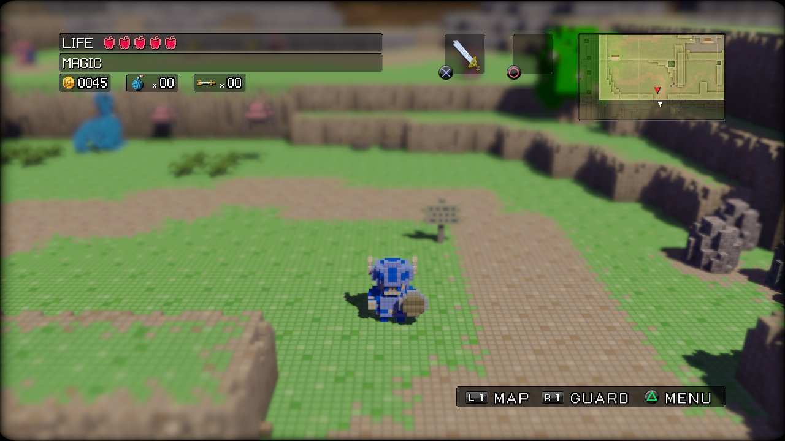
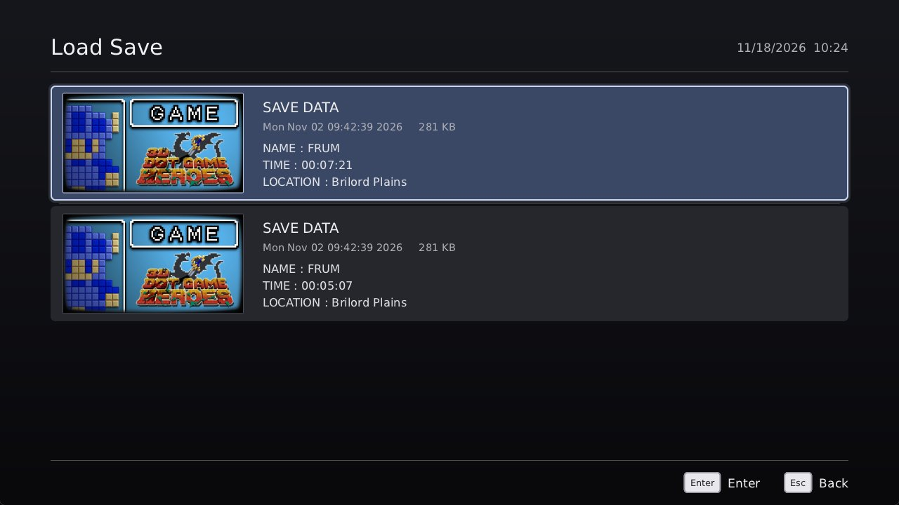

## Join the Cubic Heroes Discord!

**[Join us on Discord!](https://discord.gg/ZcafYCYb7A)**

Come hang out with the Cubic Heroes community! Keep up with the latest game updates, get help installing or troubleshooting, share your experiences, or just stop by to hype up the game and chat with fellow players.

Everyone is welcome, whether you're playing on Windows or Linux!

<p align="center">
  
</p>

<h1 align="center">Cubic.Heroes</h1>

<p align="center">
  <b>A native PC port of the PlayStation 3 game 3D Dot Game Heroes, rebuilt on your PC from your own disc.</b>
</p>

<p align="center">
  <a href="https://github.com/irnutsmurt/Cubic.Heroes/releases"></a>
  <a href="LICENSE"></a>
  
  
  
</p>

<p align="center">
  <a href="https://github.com/irnutsmurt/Cubic.Heroes/releases/tag/v0.2.0-beta.4"><b>Download the beta (0.2.0-beta.4, a pre-release: Windows and Linux)</b></a>
  &nbsp;·&nbsp; <a href="#installation">Installation</a>
  &nbsp;·&nbsp; <a href="docs/CLI.md">Command line</a>
  &nbsp;·&nbsp; <a href="#known-issues">Known issues</a>
  &nbsp;·&nbsp; <a href="https://github.com/irnutsmurt/Cubic.Heroes/issues/new/choose">Report a bug</a>
</p>

> [!IMPORTANT]
> **This is a beta, a pre-release -- not a stable release.** 0.2.0-beta.4 is the fourth public test release, for
> Windows and Linux: the whole game plays, but not every part of it has been tested yet. Expect bugs, keep backups of
> your saves (the launcher makes them), and please
> [report what you find](https://github.com/irnutsmurt/Cubic.Heroes/issues/new/choose).
> **No game code, data or keys are included** -- you need your own copy of the game.
>
> **New in 0.2.0-beta.4: updates install themselves**, on Windows and Linux. Coming from beta.2 or beta.3? Install
> beta.4 once by hand ([Updating](#updating)); from then on the launcher does it.

<p align="center">
  
</p>

**Cubic.Heroes** turns your own copy of the US PlayStation 3 release of **3D Dot Game Heroes** (Silicon Studio /
FromSoftware, 2009) into a native Windows or Linux game. The game's own program is **statically recompiled** -- its
PowerPC machine code translated ahead of time into C++ and compiled for x86-64 on your PC -- and runs on a native
engine reconstruction: a Vulkan renderer in place of the PS3's graphics chip, native code in place of its SPU
co-processor tasks, OpenAL Soft for audio and FFmpeg for the movies. Nothing is emulated or interpreted while you
play, and on Linux it is a native Linux program: no Wine, Proton or RPCS3.

It is a preservation project: the game's own logic, exactly as shipped, kept playable on today's PCs -- with the
improvements a PC version should have (high frame rates, any display mode, your own controls) and none of the game's
content changed.

## Contents

- [Screenshots](#screenshots)
- [Features](#features)
- [How it works](#how-it-works)
- [Installation](#installation) · [Playing](#playing) · [Updating](#updating) · [Command line](#command-line)
- [Troubleshooting](#troubleshooting)
- [Testing status](#testing-status) · [Known issues](#known-issues) · [Reporting bugs](#reporting-bugs)
- [Roadmap](#roadmap)
- [Building from source](#building-from-source)
- [This repository contains no game data](#this-repository-contains-no-game-data)
- [License](#license)

## Screenshots

<table>
  <tr>
    <td width="50%"><br><sub>The overworld</sub></td>
    <td width="50%"><br><sub>A dungeon</sub></td>
  </tr>
  <tr>
    <td><br><sub>A boss battle (the sword's full-life beam)</sub></td>
    <td><br><sub>The character editor: build your own hero from blocks</sub></td>
  </tr>
  <tr>
    <td><br><sub>The controller-friendly launcher</sub></td>
    <td><br><sub>Every shader and pipeline prepared before you play</sub></td>
  </tr>
  <tr>
    <td><br><sub>PC display, frame-rate and performance settings</sub></td>
    <td><br><sub>QUIT GAME on the title menu</sub></td>
  </tr>
  <tr>
    <td><br><sub>The in-game settings menu (hold L3+R3, or F1)</sub></td>
    <td><br><sub>Loading a save</sub></td>
  </tr>
</table>

<sub>Screenshots taken in game via Windows 11.</sub>

## Features

**The game, native**
- **Static recompilation to x86-64**: the game's PPU program is translated ahead of time to C++ and compiled on your PC
  for your CPU; no interpreter, no just-in-time compiler.
- **A native Vulkan renderer**: the game's PS3 graphics backend and its post-processing are drawn natively; the PS3's
  graphics command stream is not generated or decoded at all. The game's shaders are translated to SPIR-V.
- **Native physics and SPU workloads**: collision, the physics solver, the map packs' decompression, the water and the
  hero's waving cloth run as native code; no SPU program runs. (The water's and the cloth's native code is generated on
  your PC from your own copy.)
- **OpenAL Soft audio** in place of the game's proprietary audio middleware, and **FFmpeg** for the cinematics -- the
  middleware's code is left out of your recompiled game entirely.
- **Comprehensive shader and pipeline preparation**: every shader and pipeline the game uses (2,458 on the reference
  PC) is prepared ahead of play, so new places don't stutter.

**PC features**
- **High frame rates** with the game's timing corrected where it counted frames (bosses, enemies): frame limits from
  30 (the original) to 240 fps, your display's rate, a custom value or unlimited; **VSync** on or off, independently.
- **Windowed, borderless or exclusive fullscreen**, the window's size and place remembered.
- **Rendering resolution** apart from the window: native (your display's), 720p (the original), 1080p, 1440p, 4K or
  custom -- above your display's for supersampling or below it for speed, the picture's shape always kept.
- **Keyboard and controller customization**: your own buttons and keys.
- **Button prompts throughout the game** in the style of what you play with -- switching by itself to the controller
  or keyboard you used last, or the one you choose: Xbox, PlayStation (the game's original pictures), Nintendo
  Switch, Steam, a generic controller, keyboard and mouse. Every menu, the HUD, messages, tutorials, shops, the
  character editor and the minigames show the button or key that does it, after your own remapping.
- **An in-game settings menu** over the paused game: display, audio, controls and performance, changed while you play.
- **QUIT GAME** on the title menu.

**Launcher and installation**
- **A controller-friendly launcher** (`CubicHeroes.exe` on Windows, `CubicHeroes` or the AppImage on Linux): install
  from your disc, prepare shaders, play, check for updates, roll back, back up and restore saves, export
  diagnostics -- with a controller, or a keyboard and mouse.
- **Portable installation**: everything stays in one folder -- the recompiled game, saves and backups, settings, shader
  caches, logs. Move it and it keeps working.
- **Direct play from the command line**, and **third-party launcher integration**: `CubicHeroes --play` starts the
  game without the launcher's window and exits with it; `--status --json` and a headless `--install` for scripts;
  "Add to Steam" and Start-menu shortcuts (on Linux, Heroic and Lutris too: [Other launchers](#other-launchers)).
- **Signed updates and rollback**: updates are offered only if signed with the project's release key, and every
  download is checked against that signature; the game is rebuilt only when something it is made of changed; the
  previous build is kept to go back to. Since 0.2.0-beta.4 the launcher installs its own updates when it restarts,
  and keeps the launcher it replaced to go back to ([Updating](#updating)).
- **Save backups and restoration**: automatic before every update, and on demand.
- **Diagnostics and crash reporting**: crash and hang reports, logs, and a diagnostics export that removes your name,
  paths and e-mail addresses and never includes saves, keys or game files.
- **Optional developer mode** for testers: warp anywhere, set the story's progress, spawn enemies and bosses -- on test
  saves of its own, never yours, and fully off unless switched on.

## How it works

1. **Your disc is checked** (its SHA-256 against the one supported release) and the game's program is decrypted with
   your own keys.
2. **The program is recompiled**: each PowerPC function becomes a C++ function, compiled with a bundled Zig/Clang
   toolchain into a native x86-64 executable on your PC. Your recompiled game
   never leaves your machine.
3. **The PS3's hardware work is done natively** -- not emulated:

| On the PS3 | In Cubic.Heroes |
|---|---|
| RSX graphics chip, its command buffer and the game's GCM graphics backend | a native Vulkan renderer fed from the game's own draw data; no command stream is generated or decoded |
| Shader programs (NV40 microcode) | translated to SPIR-V and prepared ahead of play |
| SPU co-processor tasks (physics, water, cloth, decompression) | native C++ (the physics derived from Bullet 2.74's algorithms; the water and cloth generated from your copy's code) |
| The game's audio middleware | a native sound manager on OpenAL Soft (the middleware's code is not compiled) |
| Bink video | FFmpeg's open-source Bink decoder |
| The PS3's pad, file system, save data, threads and timers | native implementations of the system interfaces the game calls |

**What remains PS3-shaped**, to be precise: the recompiled game still runs on its own big-endian memory layout and
calls the PS3 system interfaces it was written against (memory and display-buffer mapping, flip status, pad, file
system, save data, threads, locks and events); those interfaces are implemented natively on the PC, not emulated. The
game also still creates the (now empty) SPU task-scheduler instances it expects; no task is ever given to them. The
recompiler and runtime are [ps3recomp](https://github.com/sp00nznet/ps3recomp), patched by this project
(`patches/ps3recomp/`).

## Installation

### What you need

- **Windows 10 or 11, 64-bit**, or **Linux on x86-64 with glibc 2.31 or newer** (Debian 11, Ubuntu 20.04 and
  Fedora 32 have that glibc; see [Testing status](#testing-status) for what has actually been tested).
- An **x86-64 CPU with SSE4.2** (x86-64-v2: Intel since 2008, AMD since 2011).
- A GPU with a **Vulkan** driver: any recent AMD, NVIDIA or Intel driver on Windows; on Linux, Mesa's (RADV for AMD,
  ANV for Intel) or NVIDIA's.
- About **6 GB** of free disk space.
- Nothing else to install: the launcher carries its own runtime (on Linux too: no Python or SDL from the system).
  The AppImage needs FUSE; the tarball doesn't.

  These are the minimum; recommended requirements will follow once more hardware has been tested.
- **Your own copy of the game** -- only this release is supported:

| | |
|---|---|
| Title | 3D Dot Game Heroes (USA), PlayStation 3 |
| Product number | **BLUS-30490** |
| Version | 01.00 |

  Other regions and releases are rejected (the recompilation is tied to this exact build's code). This project does
  not include the game or its keys and does not tell you where to get them.
- **A dump of your disc**, one of:
  - a **decrypted ISO** (3,332,812,800 bytes), as made by a PS3 running homebrew backup software in decrypted mode;
  - an **encrypted ISO** (a raw Blu-ray rip) with its **disc key** (a `.dkey` file, the 32-character key, or an IRD
    file) -- decrypted as it is read; the ISO itself is never changed;
  - the disc's **folder** (the one holding `PS3_GAME/`).
- **Your keys file** to decrypt the game's program (`APP <revision> <erk> <riv>` lines; this game needs revision
  `0001`), or an `EBOOT.elf` you decrypted yourself (for example with RPCS3's *Utilities > Decrypt PS3 Binaries*
  using your own console's firmware). The keys are only read: never copied, logged or uploaded.

Every download is on the [0.2.0-beta.4 release page](https://github.com/irnutsmurt/Cubic.Heroes/releases/tag/v0.2.0-beta.4),
with `SHA256SUMS.txt` and the signed manifest (`release.json`, `release.json.sig`) to check them against.

On every system the launcher does the same: you choose your disc and your keys file, and it checks the disc, decrypts
the game's program and **recompiles it on your PC** (10-30 minutes, depending on your CPU), then prepares the shaders
(a few seconds to a few minutes). Nothing of the game is downloaded: it is built from your own files.

### Windows

1. **Download** `Cubic.Heroes-0.2.0-beta.4-windows-x86_64.zip`.
2. **Extract** it where you want the game to live -- for example `D:\Games\`. It unpacks to a `Cubic.Heroes` folder;
   that folder *is* the installation.
3. **Run `Cubic.Heroes\CubicHeroes.exe`**, choose your disc and your keys file, and **Install**.
4. **Shaders** are prepared right after the install; the launcher's Shaders page shows their state and can prepare
   them again after a GPU driver change.
5. **Play.**

An installation from an earlier version in `%LOCALAPPDATA%` is found on the first start and offered: copied into the
new folder and checked file by file, the earlier folder left as it was.

### Linux: the AppImage

1. **Download** `Cubic.Heroes-0.2.0-beta.4-x86_64.AppImage` into the folder you want the game in (for example
   `~/Games/`).
2. **Make it executable** -- `chmod +x Cubic.Heroes-0.2.0-beta.4-x86_64.AppImage`, or the file's Properties >
   Permissions -- and **start it**.
3. Choose your disc and your keys file, and **Install**, as on Windows.

The AppImage is one read-only file: its installation is a **`Cubic.Heroes` folder created beside it** (in the example,
`~/Games/Cubic.Heroes/`), holding everything listed under [The portable folder](#the-portable-folder). **Move the
AppImage and that folder together**, keeping them side by side.

**FUSE**: an AppImage is mounted with FUSE while it runs; most desktop distributions have it (on some it is the
`fuse2` or `libfuse2` package). Without FUSE, use **the tarball** below. `--appimage-extract-and-run` works too, but
leaves an extracted copy (about 450 MB) in `$TMPDIR` (normally `/tmp`) until it is deleted or the machine restarts
([docs/LINUX_PACKAGING.md](docs/LINUX_PACKAGING.md)).

### Linux: the tarball

1. **Download** `Cubic.Heroes-0.2.0-beta.4-linux-x86_64.tar.xz` and **extract** it where you want the game to live:
   `tar -xJf Cubic.Heroes-0.2.0-beta.4-linux-x86_64.tar.xz -C ~/Games`. It extracts to a `Cubic.Heroes` folder; that
   folder *is* the installation, exactly as on Windows.
2. **Run `Cubic.Heroes/CubicHeroes`**, choose your disc and your keys file, and **Install**.

The tarball needs no FUSE and leaves nothing outside its folder: use it on systems without FUSE, or if you prefer a
plain folder. The launcher (`CubicHeroes`), its runtime (`worker/`) and its libraries (`lib/`) sit beside the
installation's own folders.

### Other launchers

- **Steam** (Windows and Linux): the launcher's **Add to Steam** (Settings) adds the game as a non-Steam game, started
  with `--play`. Close Steam first.
- **Heroic or Lutris** (Linux): add the tarball's `Cubic.Heroes/CubicHeroes` as a **native** game (not Wine or
  Proton) with the argument `--play`. Heroic's Flatpak can read only some folders (your Documents, the desktop, and
  others it already allows); for an installation elsewhere, allow it once with
  `flatpak override --user --filesystem=<the installation folder> com.heroicgameslauncher.hgl`.
- **Playnite, LaunchBox and others** (Windows): point them at `CubicHeroes.exe --play` ([docs/CLI.md](docs/CLI.md)).

### The portable folder

Everything the game and the launcher make stays inside the `Cubic.Heroes` folder:

| Folder | What |
|---|---|
| `data/gamedata/` | **your saves** |
| `backups/saves/` | save backups (automatic before updates, and your own) |
| `config/` | settings (`dotheroes.cfg`), the window's place, the launcher's preferences |
| `builds/` | the recompiled game (the active build and the previous one) |
| `data/cache/` | shader, pipeline and compiler caches |
| `logs/` | logs; `logs/crash/` crash and hang reports |

Move the whole folder and it keeps working (to copy it, see
[The installation was copied](#the-installation-was-copied-game-is-in-the-way)). Nothing is written to `AppData` by default; the only things
outside it are the shortcuts and Steam entry you ask for and your GPU driver's own caches. Another folder can be used
for the data (`--install-dir`, or Settings). To remove everything, use the launcher's uninstall, or delete the folder.

## Playing

| Keyboard | PS3 |
|---|---|
| Arrows | D-pad |
| Z / X / A / S | Cross / Circle / Square / Triangle |
| Q / W | L1 / R1 |
| 1 / 2 | L2 / R2 |
| 3 / 4 | L3 / R3 |
| Enter | Start |
| Tab | Select |

Any controller SDL2 recognises works, connected or disconnected while you play; buttons and keys can be changed in the
in-game menu. **The in-game menu**: hold **L3 + R3**, or press **F1** or **Esc** -- the game pauses while it is open.
The game's own START menu is unchanged; its title menu ends with **QUIT GAME**.

Settings are shared by the launcher and the in-game menu:

| Setting | Values |
|---|---|
| Display mode | windowed (resizable; its size and place remembered), borderless, exclusive fullscreen (your display's own mode) |
| Rendering resolution | native (default: your display's in fullscreen, the window's in a window), 1280x720 (the original), 1920x1080, 2560x1440, 3840x2160, custom -- changed while you play; independent of the display mode and the window's size; your display's own resolution is never changed |
| VSync | on / off, independent of the frame limit |
| Frame limit | 30 (the original), 60 (default), 75, 100, 120, 144, 165, 240, your display's rate, custom, unlimited |
| Volumes | master, music and effects, 0-100, and mute -- applied at once |
| Controls | your own controller buttons and keyboard keys; the button prompts (automatic, Xbox, PlayStation, Nintendo Switch, Steam, generic, keyboard and mouse); the in-game menu's shortcut |
| Performance overlay | off, the frame rate, or the frame rate and frame times |

## Updating

**Since 0.2.0-beta.4 the launcher installs updates itself.** It checks for new versions (betas on the pre-release
channel, a beta's default; Settings > Updates). **Download it** downloads a new version and checks it against the
project's release signature; **Restart and update** then:
- checks the download again (the signature, and that it is this system's package of your kind of installation);
- closes the launcher, puts the new version's files in place of its own, and opens the new version;
- brings the game up to date if the new version needs it (your saves are backed up first; the previous build is kept:
  Install > **Rollback Last Update** goes back to it).

Your saves, settings, shader caches, logs and builds stay as they are. The launcher it replaced is kept: **Go back to
version ...** on the Updates page (or `CubicHeroes --rollback-launcher`). If an update is stopped part-way -- the
launcher or the computer stopping in the middle -- the previous launcher is put back at the next start. On Linux the
AppImage is replaced in place, keeping its name and its shortcuts. No administrator or root rights are needed. Close
the game first: an update isn't installed while it runs. From a terminal: `CubicHeroes --check-update`, then
`CubicHeroes --apply-update`, then `CubicHeroes --update` for the game ([docs/CLI.md](docs/CLI.md)).

### From beta.2 or beta.3: once by hand

Their launchers can't install updates (and beta.3's can't reach the update server on Linux), so install beta.4 by
hand once; from then on updates install themselves.

1. **Back up your saves** (the launcher's Saves > Back up now), then **close the launcher and the game**.
2. **Put beta.4 in place of your version**. Only the launcher's own files are replaced; your installation's folders
   are not touched:
   - **Windows**: extract the beta.4 zip into the folder that *holds* your `Cubic.Heroes` folder (for
     `D:\Games\Cubic.Heroes`, into `D:\Games`), so that it merges with yours, and replace the files when asked. In
     Windows Explorer: right-click the zip > Extract All..., set that folder as the destination, then *Replace the
     files in the destination*. In PowerShell: `Expand-Archive -Force <the zip> -DestinationPath D:\Games`.
   - **Linux, the tarball**: extract it into the folder that holds `Cubic.Heroes`, the same way:
     `tar -xJf <the tarball> -C ~/Games`.
   - **Linux, the AppImage**: put the beta.4 `.AppImage` beside the old one (beside the `Cubic.Heroes` folder) and
     make it executable; it uses the same installation. Then remove the old file, or keep it. If Steam, Heroic or
     Lutris start the old file, point them at the new one.
   - If you renamed the `Cubic.Heroes` folder, extract the zip or tarball somewhere else instead, and copy the
     contents of its `Cubic.Heroes` folder into yours, replacing the files.
3. **Start the launcher**. It brings the game up to date with beta.4 by itself: from beta.3 in a few seconds (the game
   itself hasn't changed); from beta.2 by rebuilding it from your disc's conversion (about 6 minutes on a recent
   desktop CPU; no disc needed), your saves backed up first and beta.2's build kept (Install > **Rollback Last
   Update**). From a terminal instead: `CubicHeroes --update` in the installation's folder.

These steps were tested before release from the published packages: beta.2 and beta.3 on Windows, beta.3 with the
Linux tarball and with the AppImage -- the saves and settings byte for byte the same, the game played afterwards, and
from beta.2 the rollback to beta.2's build still in place after the launcher was started again.

## Command line

The launcher is also a command-line program (`CubicHeroes.exe` on Windows; `CubicHeroes`, or the AppImage itself,
on Linux) -- for other launchers, Steam and scripts:

```bash
CubicHeroes --play                                   # the game directly, no launcher window; exits with the game
CubicHeroes --play --fps 144 --borderless            # this session only (add --persist to keep it)
CubicHeroes --play --resolution 2560x1440            # the rendering resolution, apart from the window's size
CubicHeroes --status --json                          # installed? which build? shaders prepared? (machine-readable)
CubicHeroes --install --disc "D:\Dumps\BLUS30490.iso" --keys "D:\Keys\keys.txt"   # headless install
CubicHeroes --update                                 # bring the game up to date (rebuilds only what changed)
CubicHeroes --prepare-shaders
CubicHeroes --install-dir "E:\Games\Cubic.Heroes" --play   # another installation folder
```

For Steam, Playnite, LaunchBox and similar: point them at `CubicHeroes.exe --play`; it stays running for as long as
the game does and returns its exit code. Everything -- every option, the JSON output, exit codes and integration
examples -- is in **[docs/CLI.md](docs/CLI.md)**.

## Troubleshooting

| Problem | What to do |
|---|---|
| The disc is refused | Only BLUS-30490 version 01.00 is supported; check the dump (size 3,332,812,800 bytes for an ISO) |
| The keys file is refused | It needs an `APP` line for revision `0001`; or decrypt `EBOOT.BIN` yourself and give the `EBOOT.elf` |
| The install stopped part-way | Run Install again: it resumes where it stopped |
| Stutter the first time somewhere | Shaders page: prepare them (again after a GPU driver update) |
| The game is too fast or slow | Report it with your frame limit and display rate; set the frame limit to 60 meanwhile |
| A black screen or the game won't start | Update your GPU driver (Vulkan); Diagnostics > Export Logs, and report it |
| The folder can't be written | Extract to a folder you own (not `Program Files`); the launcher says if it can't write |
| Linux, beta.3: the update check says "Offline" though you're online | A known issue of 0.2.0-beta.3, fixed in beta.4: install beta.4 by hand once ([From beta.2 or beta.3](#from-beta2-or-beta3-once-by-hand)) |
| Linux: "couldn't verify the update server's certificate" | The system has no trusted certificate store the launcher can use: install your distribution's `ca-certificates` package, or start the launcher with `SSL_CERT_FILE` set to a CA bundle (for example `SSL_CERT_FILE=/etc/ssl/certs/ca-certificates.crt ./Cubic.Heroes/CubicHeroes`) |
| Linux: "The AppImage's folder can't be written" | The AppImage is in a folder you can't write to (`/opt`, for example), so it can't update itself: download the new AppImage from the releases page, or keep the AppImage in a folder of yours |
| Linux: the AppImage doesn't start | Make it executable (`chmod +x`); without FUSE, use the tarball ([Linux: the AppImage](#linux-the-appimage)) |
| Linux: Heroic can't start the game or doesn't see its folder | Add `CubicHeroes` as a native game with `--play`, and allow the folder for Heroic's Flatpak ([Other launchers](#other-launchers)) |
| Linux on Wayland: exclusive fullscreen looks like borderless | Expected: on Wayland the compositor owns the display mode, so exclusive fullscreen behaves as borderless |
| An update, a repair or going back to an earlier build fails with "...game is in the way (not a link)" | The installation folder was copied in a way that turned its `game` link into a plain folder: see [The installation was copied](#the-installation-was-copied-game-is-in-the-way) |
| Something else | Diagnostics > Export Logs, review, save the zip -- and [open an issue](https://github.com/irnutsmurt/Cubic.Heroes/issues/new/choose) |

### The installation was copied: "game is in the way"

Inside the installation folder, `game` is a link to the build in use (a junction on Windows, a symbolic link on
Linux), not a folder of its own. Some ways of copying the installation copy the build's files into a plain `game`
folder instead: Windows Explorer copying it to another drive, for example, or on Linux `cp -r` without `-a` or a
file manager that follows links. The game still plays,
but updating, repairing and going back to an earlier build stop at their last step with "...game is in the way (not
a link)". This is a known limitation of 0.2.0-beta.4 (and earlier); a fix is planned.

**To check**, open a command prompt in the installation folder and run `dir`:
- a healthy installation lists `<JUNCTION>  game [...\builds\...]`;
- a copied one lists `<DIR>  game`.

In PowerShell, `(Get-Item game).LinkType` says `Junction`, or nothing for a copied folder. On Linux, `ls -l` shows
`game -> builds/...` for the link, and a plain `game` directory for a copied one.

**To recover safely** (nothing is deleted before it is checked):
1. Close the game and the launcher.
2. Find the build in use. `CubicHeroes --status --json` names it (`builds`, then `active`), and so does the `active`
   line of `active.json` in the installation folder.
3. Compare the `game` folder with that build's own folder, `builds\<the build in use>`. It should hold the same files
   and nothing else:
   - the game's program (`dotheroes.exe`; `dotheroes` on Linux);
   - its libraries (`.dll` files on Windows; the `lib` folder on Linux);
   - `build.json`, `build.cfg`, `icon.png`;
   - on Windows, the libraries' licence notices (on Linux they're inside `lib`).

   Your saves and settings are never in `game`: they are in `data` and `config`.
4. Move the `game` folder out of the installation folder (to your desktop, for example). Don't delete it yet.
5. Open the launcher and run the update (or Repair) again: it makes `game` a link again. Then play to check.
6. Delete the folder you moved, but only if step 3 found nothing in it except those files. If it held anything else,
   keep it and report it with Diagnostics > Export Logs.

**To avoid it**:
- Move the installation folder on the same drive (cut and paste): a move keeps the link.
- To copy it elsewhere, use a copy that keeps links or leaves them out:
  - `robocopy` with `/XJ` leaves the link out, and the launcher makes it again on the next update;
  - on Linux, `cp -a` or `rsync -a` keep the link.

## Testing status

**Windows**: the beta has been validated area by area on Windows 11 with an NVIDIA GPU: every reachable map visited
(166 of 167), every boss fought to its defeat (and won by the game's own mechanics where they need one), the ending
and credits, saving and loading, frame-rate independence of movement at 30, 60, 144 and 240 fps for every enemy type
and the bosses, the movies, every event the game places, the installation, updating by hand from the previous beta,
and rollback -- with automated scenarios, the developer tools and comparisons against RPCS3.

**Linux**: played and qualified on one machine, a Ryzen 5 5500U laptop with Radeon graphics (Manjaro Linux, kernel
6.18, Mesa 26.2 RADV), under KDE Plasma on Wayland and on X11 -- the installation from the disc, the shaders, play, saves, both packages (the AppImage
and the tarball), and the game started through Steam (as a non-Steam game, with the Steam overlay and a controller)
and through Heroic's Flatpak; Lutris on an earlier package of the same day. On Debian 11, Ubuntu 20.04, Ubuntu 24.04
and Fedora 41 the packages have only been started in clean containers (the launcher, its command line, the worker and
the game's own start-up checks): the game hasn't been played there.

The full matrix, with what is still `partial` or `todo`, is [docs/M11_VALIDATION.md](docs/M11_VALIDATION.md); the
release checks are [docs/RELEASE_QUALIFICATION.md](docs/RELEASE_QUALIFICATION.md). **Not every part of the game has
been tested**, and Windows 10, AMD and Intel GPUs on Windows, NVIDIA and Intel GPUs on Linux, other distributions and
handhelds (the Steam Deck among them) have not been tested at all -- reports are very welcome.

### Known issues

- **B-011**: a hang was seen once in the priest's arena, 13 minutes into a long fight; not reproduced in more than two
  hours of the same fight since. If the game freezes, Diagnostics > Export Logs collects the hang report.
- **B-007**: one effect frame is missing when arriving at the castle battle's arena (cosmetic).
- The **minigames** run, but none has yet been played to its end in testing.
- The **extra Block Defense stage** is drawn pink in play; not yet compared with the original.
- The **purple spell** works only at its puzzle places, as on the original; two of its three places are still to be
  tested.
- The keyboard has no right stick: the camera's prompts keep a stick's picture there.
- The editor's own world, New Game+'s carry-over, the side quests and the consumables are not yet fully tested.
- **A copied installation folder** can stop updates, repairs and going back to an earlier build ("game is in the
  way"). It happens when the folder is copied in a way that turns its `game` link into a plain folder. See
  [The installation was copied](#the-installation-was-copied-game-is-in-the-way) for how to check and recover safely.
- **Coming from beta.2 or beta.3 takes one manual step**: their launchers can't install updates (and beta.3's can't
  reach the update server on Linux), so beta.4 is installed by hand once ([From beta.2 or
  beta.3](#from-beta2-or-beta3-once-by-hand)); updates install themselves after that.
- **An update waits for the game to close**: the launcher doesn't install one while the game is running.
- **Windows: a console window flashes for about two seconds** after the launcher installs an update or removes itself:
  its helper waiting a moment, then deleting its own temporary copy. Nothing to do; a fix is planned.
- **An AppImage in a folder you can't write to** (`/opt`, for example) can't update itself: the launcher says so
  before downloading anything; download the new AppImage from the releases page instead.
- **Linux**:
  - without FUSE, use the tarball: an AppImage started with `--appimage-extract-and-run` leaves its extracted copy in
    `$TMPDIR` (normally `/tmp`) until it is deleted or the machine restarts;
  - on Wayland, exclusive fullscreen behaves as borderless fullscreen (the compositor owns the display mode);
  - on AMD graphics a few shadows and floor reflections differ slightly from the reference captures (faint; nothing
    missing or misplaced); being investigated.

### Reporting bugs

Use the [issue forms](https://github.com/irnutsmurt/Cubic.Heroes/issues/new/choose) -- gameplay, rendering, crashes and
hangs, performance, installation and the launcher, hardware -- and attach the launcher's **Diagnostics > Export Logs**
zip (review it first; it removes your name and paths). **Never attach game files, keys, save files or personal
information.**

## Roadmap

Done:

- **The first native Linux release** -- an **AppImage** and a **tarball** for x86-64, in 0.2.0-beta.3
  ([docs/LINUX_PACKAGING.md](docs/LINUX_PACKAGING.md)).
- **Updates installed by the launcher itself** on Windows and Linux, with rollback of the launcher and recovery of an
  interrupted update, and Linux's update check fixed -- in 0.2.0-beta.4.

Planned, not yet available:

- **0.2.0-beta.5**: the slowdown when cutting grass and other debris-heavy scenes
  ([#2](https://github.com/irnutsmurt/Cubic.Heroes/issues/2)), measured on Windows and Linux before any change; a
  stronger release-signing design (an offline root key with delegated release keys); optional RecompLauncher
  support (launching and settings), alongside the standalone launcher.
- **Completing the gameplay validation** -- the rows still open in the matrix, and what testers report.
- **Steam Deck** testing and compatibility.
- **Further Linux compatibility** -- NVIDIA and Intel GPUs, more distributions and desktops, and the AMD rendering
  differences above.
- **Optional hardware-accelerated ray tracing** (RTX and other GPUs with ray tracing).
- **HDR** output (being considered).
- **Character import, export and community sharing** -- the editor's heroes as files, and a shared library.

## Building from source

For developers. A clone builds the tools and the runtime -- not the game, which still needs your own disc.

- Windows: Python 3.12 in `build/venv` (with `pycryptodome`, `pillow`, `pyinstaller`), CMake, Ninja, Zig 0.17 in
  `build/toolchain/`, the Vulkan SDK.
- Linux: Python 3.10+ with `pycryptodome`, CMake 4, Ninja, Zig 0.17 (`tools/fetch_zig.py`) and the system's X11,
  Wayland, udev, PulseAudio and ALSA headers; the release packages are built in the pinned container of
  `tools/linux_package.py` (glibc 2.31 baseline) ([docs/LINUX_PACKAGING.md](docs/LINUX_PACKAGING.md)).

```sh
python3 tools/pipeline.py --iso "<your BLUS-30490>.iso" --keys <keys.txt>   # extract, decrypt, lift into build/gen
cmake -S port -B build/port -G Ninja -DPS3RECOMP_RSX_VULKAN=ON
cmake --build build/port
build/port/dotheroes build/disc/PS3_GAME/USRDIR/EBOOT.elf
```

The pipeline clones [ps3recomp](https://github.com/sp00nznet/ps3recomp) at a pinned revision and applies this
project's patch series (`patches/ps3recomp/`). The downloads: `tools/build_deps.py`, then
`tools/make_bundle.py --prebuilt` (the launcher with `tools/build_launcher.py`). Before every push the pre-push hook
runs `tools/boundary_check.py` and `tools/push_guard.py` (`git config core.hooksPath tools/githooks`).

| Path | What |
|---|---|
| `launcher/` | the launcher, `CubicHeroes` (SDL2 and Dear ImGui), and its command line |
| `setup_app.py`, `tools/worker.py` | the worker the launcher runs: install, update, prepare, diagnostics |
| `tools/` | the recompilation pipeline, the build with Zig, the downloads, the checks |
| `patches/ps3recomp/` | this project's changes to the ps3recomp recompiler and runtime |
| `port/` | the native program: start-up, the native renderer's hooks, physics, audio, the in-game menu, diagnostics |
| `config/` | the exact game version (hashes), the recompiler's inputs, the settings schema, the release keys |
| `tests/` | test harnesses, scenarios and the unit tests |
| `docs/` | design records, milestones, validation, the command line |

## This repository contains no game data

This project distributes the **tools that rebuild the game from your own disc**, not the game. The repository and
the download hold the recompilation tools, this project's independently written runtime code, the open-source
libraries it builds on, configuration, tests and documentation. They never hold the game's code (extracted, lifted or
translated), a built game or anything compiled from it, the game's assets, sounds, music, textures or movies,
proprietary middleware, decryption keys or firmware, or anyone's saves. Everything derived from the game is made on
your own machine and must not be redistributed. `tools/boundary_check.py` checks this on every push and on the download
before and after it is packed.

The **screenshots** in `docs/media/` are pictures of the game running, captured from a player's own installation to
illustrate this documentation. They are not game assets and nothing playable can be made from them; they are kept
apart from the download, which never contains them.

## License

This project's code is licensed under the **GNU General Public License v3.0** ([`LICENSE`](LICENSE)). The licence
covers this project's own code and images only. 3D Dot Game Heroes belongs to its rights holders (developed by Silicon
Studio, published by FromSoftware, and by Atlus in North America); none of its code or data is part of this
repository, and the GPL grants no rights to it.

Third-party components keep their own licences (their texts and, where the licence asks, their sources ship in the
download's `licenses/` folders):

| Component | Licence | Use |
|---|---|---|
| [ps3recomp](https://github.com/sp00nznet/ps3recomp) (patched, `patches/ps3recomp/`) | MIT | the recompiler and PS3 runtime |
| at3_standalone (in ps3recomp, from PPSSPP/FFmpeg) | LGPL-2.1 | ATRAC3plus decoding (its source ships in the download) |
| [SDL2](https://libsdl.org) | zlib | window and input |
| [Dear ImGui](https://github.com/ocornut/imgui) | MIT | the launcher's interface |
| [OpenAL Soft](https://openal-soft.org) 1.25.2 | LGPL-2.0-or-later (parts BSD-3-Clause, PFFFT's licence, {fmt}'s and Microsoft GSL's MIT) | the game's audio: a shared library, unmodified, its source in the download |
| [FFmpeg](https://ffmpeg.org) 9.0.2 | LGPL-2.1-or-later | the movies: avutil, avcodec and avformat with the Bink demuxer and decoders only, shared libraries, unmodified, their source and build configuration in the download |
| [glslang](https://github.com/KhronosGroup/glslang) | BSD-3-Clause and others | the game's shaders, translated |
| [Vulkan-Headers](https://github.com/KhronosGroup/Vulkan-Headers) | Apache-2.0 / MIT | building the renderer |
| [Bullet Physics](https://github.com/bulletphysics/bullet3) 2.74 | zlib | the native physics: its narrowphase compiled from source; `bullet_cd.cpp` and `bullet_solver.cpp` are altered versions of its algorithms and carry its notice |
| [Zig](https://ziglang.org) | MIT | the bundled compiler |
| [Python](https://www.python.org) 3.12 (with OpenSSL, libffi, zlib, bzip2 and the other libraries its Windows build carries) | PSF License 2.0; the libraries' own (Apache-2.0, MIT, zlib, BSD) | the worker's runtime |
| [PyInstaller](https://pyinstaller.org)'s bootloader | GPL-2.0-or-later with its bootloader exception | starts the packed worker |
| [pycryptodome](https://www.pycryptodome.org) | BSD-2-Clause / public domain | decrypting the game's program |
| [DejaVu Sans](https://dejavu-fonts.github.io) (`port/assets/ui/`) | Bitstream Vera / DejaVu font licence | interface text |
| [Kenney input prompts](https://kenney.nl) (`port/assets/ui/`) | CC0 | controller button prompts |

> **Built with AI.** This project's code -- the pipeline, the runtime changes and patches, the launcher and the
> tooling -- was written by AI ([Claude Code](https://claude.com/claude-code), Anthropic's Claude), with a human
> directing and testing it. This repository was called `3D-Dot-Game-Heroes-PS3-Recomp` until November 2026; links to
> the old name lead here.
